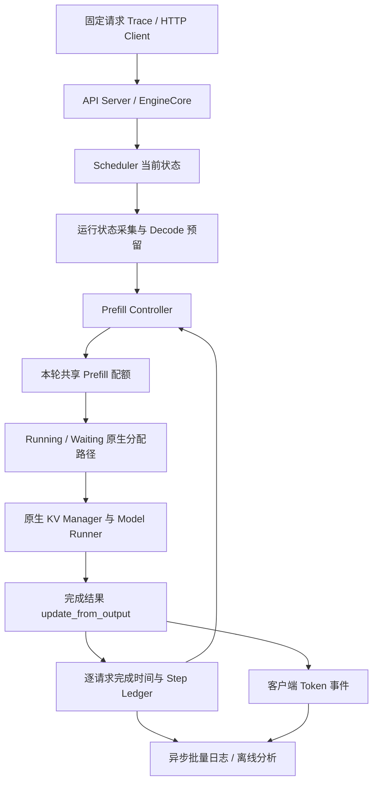

# 基于本地 vLLM V1 的动态 Prefill Budget 调度项目设计

**版本：V2.0 · 本地环境适配与实施设计**  
**日期：2026-10-19（Asia/Shanghai）**  
**项目目录：`/home/sdn/wjh/Ondeviceinfer/source/adaptive_prefill_budget`**  
**英文名称：Adaptive Prefill Budget Scheduling for Latency-Sensitive LLM Serving**

本文根据用户提供的《基于 vLLM V1 的动态 Prefill Budget 调度优化》附件，以及本机实际环境、已安装源码和已有实验工程重新设计。本文中的“新增”“计划”“验收”均表示后续实施内容；本次交付为设计文档与环境核验记录，没有运行本项目性能实验，也没有声称动态策略已获得收益。

## 1. 项目决策与研究目标

主线使用**本地 vLLM 0.32.0+cu129、Qwen3-1.7B FP16、单张 RTX 3090 24 GiB**。直接复用现有权重和二进制依赖，在独立源码副本中增加每轮共享的 Prefill 计算配额，逐步实现 Fixed、Load-Aware、Latency-AIMD、Load+AIMD 与 Aging。先在同步 Eager 路径验证语义，再在原生 Async、torch.compile、CUDA Graph 路径验证部署效果。

研究问题：在相同硬件、模型、总 Token 上限、请求 Trace 和执行路径下，动态 Prefill 配额是否能在保持可接受 TTFT 与吞吐的条件下，降低混合负载的 Decode P95/P99 ITL，并改善相对于最佳静态策略的权衡？

项目应产出三类结论：

1. **机制证据**：长 Prefill 工作量、混合 Step 时长与 Decode 间隔之间的关联及受控干预结果。
2. **工程证据**：预算、KV 生命周期、异步状态、取消和抢占恢复保持正确。
3. **性能证据**：独立测试 Trace 上的收益、代价、置信区间与不适用场景。

不预设提升百分比；若自适应不优于最佳静态预算，应保留负结果并解释原因。已有 KV 排序项目的收益不能计入本项目。

## 2. 本次核验结果与本地资源

### 2.1 硬件与软件

| 项目 | 本次核验值 | 使用方式 |
| --- | --- | --- |
| GPU | NVIDIA GeForce RTX 3090，24576 MiB | 单卡，TP=PP=DP=1 |
| 驱动 | 570.86.15 | 复用，不因本项目升级 |
| 主环境 Python | 3.11.16 | 独立既有环境 |
| 主环境 vLLM | 0.32.0+cu129 | 发行包元数据实查 |
| PyTorch / CUDA Runtime | 2.13.0+cu129 / 12.9 | 已实查 CUDA 可用 |
| Triton / Transformers | 3.7.1 / 5.19.0 | 沿用现有锁文件 |
| 备用环境 | vLLM 0.11.2，Torch 2.9.0+cu128，CUDA 12.8 | 可选移植，不纳入首轮矩阵 |
| 系统内存 | 约 125 GiB | 仅为核验时快照 |
| 数据盘可用空间 | `/mnt/ondeviceinfer` 约 301 GiB | 存环境副本、缓存、日志和 Trace |
| 根分区可用空间 | 约 4 GiB | 工作区只存源码、小型清单和报告 |
| Nsight Systems | `/usr/local/cuda/bin/nsys` 存在 | 正式 Profile 前验证采集能力 |

`nvidia-smi` 显示的 CUDA 12.8 是驱动侧信息，不代表当前 Python 使用的 Runtime；本次 `torch.version.cuda` 为 12.9。既有报告记录该组合已运行 GPU 冒烟，本次仅核验包版本、CUDA 可用性和文件，不把既有验证当作本项目推理验收。

主环境：

```text
/mnt/ondeviceinfer/experiments/vllm_kv_scheduling_latest_v0320/environment
```

备用环境：

```text
/mnt/ondeviceinfer/conda-envs/vllm-0.11.2
```

原环境清单记录 v0.32.0 基础 Commit 为 `5df63a7203cdb9328d824a27b682e77c7b9928be`。本次重新计算了 Scheduler、AsyncScheduler、EngineCore、配置和 API 协议等文件 Hash，见 [本地核验清单](evidence/local_inventory_20261019.json)。后续准备脚本必须比较这些 Hash，拒绝在未知源码上自动打补丁。

### 2.2 模型选择

| 模型 | 本地状态 | 本项目定位 |
| --- | --- | --- |
| Qwen3-1.7B | 配置、Tokenizer、索引和两个权重分片存在 | 必选主模型，FP16 常驻 |
| Qwen3-14B | 本地模型入口存在，已有其他实验 | 不作为 FP16 常驻主基线 |
| Qwen3-14B AWQ/GPTQ 等 | 已有量化实验目录 | 可选模型扩展，另做完整性和加载验证 |
| Qwen3-14B-int8 | 自研量化产物目录 | 不能默认视为 vLLM 可直接加载格式 |
| Mistral-7B-Instruct-v0.2 | 当前目录仅有配置文件 | 不视为可用权重 |
| 附件指定 Qwen2.5-3B-Instruct | 本次检查的模型根目录中未发现 | 不作为启动前置依赖 |

主模型路径：`/mnt/ondeviceinfer/models/Qwen3-1.7B`。该路径解析到 Revision `70d244cc86ccca08cf5af4e1e306ecf908b1ad5e`。配置默认 dtype 为 BF16，实验启动时**显式指定 FP16**。本次确认分片存在和大小，并计算配置与 Tokenizer Hash；完整权重 SHA256 校验纳入 Phase 0。

Qwen3-1.7B 足以验证调度机制，且避免权重 Offload 干扰。若干扰效应过弱，先增加合法上下文长度、Decode 上下文和 Prefill 注入密度；仍不能复现时如实报告，再选择已核验的更大模型。不能为制造收益引入只在某策略启用的显存限制。

### 2.3 与已有工程的关系

已有 `/home/sdn/wjh/Ondeviceinfer/source/kvprefillschedule` 和 `vllm_kv_scheduling` 主要按 GPU/CPU 前缀命中与成本调整等待队列，部分旧版还有抢占策略。本项目改变的是**一个 Scheduler Step 内允许计算的 Prefill 总量**。

可复用：环境、模型、环境清理方法、GPU 串行锁思路、HTTP 服务生命周期、统计与 Profile 工具。需要重写或调整：ITL 逐事件采集、非共享前缀混合 Trace、预算记账和控制器。旧项目以 Prefix Cache/Offload 为中心的成本表、负载、KV 小容量配置及结果不能直接作为本项目基线。

主实验关闭旧 Admission 扩展、KV Offload 与 Prefix Cache。缓存命中和资源不足放入独立兼容性实验。后续如测试“旧排序 × 新预算”，采用四组因子实验，独立报告组合效果。

### 2.4 引用聊天的可用性

已两次调用引用聊天 `01a154b6-19cb-7aa1-a6c7-77ea72f76a26` 的读取接口；缩减到单轮且不包含工具输出后，接口仍返回体积超限。本文未依赖该聊天的内容或标题推断事实；相关环境信息来自实际文件与本次命令输出。

## 3. 相对附件的关键修订

| 附件方向 | 本地适配与补充 |
| --- | --- |
| Qwen2.5-3B FP16 | 改用已存在且曾用于服务实验的 Qwen3-1.7B FP16 |
| 泛指 vLLM V1 | 固定 0.32.0+cu129 和源码 Hash，0.11.2 仅后续移植 |
| 全局预算主要看一个参数 | 同时保留 `max_num_scheduled_tokens` 和 `max_num_batched_tokens` 两个原生约束 |
| 单引擎 Prefill Interval 基线 | 本地版本该路径无效，不能直接列为有效实验组 |
| 按请求是否 Prefill 扣预算 | 增加实际计算区间、Prompt 计算与恢复重算分类，以及分配撤销退款 |
| 只限制 Prefill 总量 | 增加 Decode Token 预留，防止 Running Prefill 提前吃满总预算 |
| 每 K Step 控制 | K 指新的、已完成且有有效 Decode 观测的 Step；不按调度提交次数重复反馈 |
| Aging 提高全局配额 | 同时记录逐请求无进度时间与阻塞原因，给出有条件的公平性保证 |
| 流式 Chunk 间隔作为 ITL | 返回 Token IDs 验证事件粒度，分开报告客户端间隔与服务端 Token 间隔 |
| 全组合消融 | 分阶段筛选，先确定机制再做独立验证，限制单卡实验规模 |

附件将 Decode 预留列为后续增强。本设计把它提前到静态配额阶段：本地源码中 Running 按原有顺序消费全局预算，存在可直接构造的队首 Partial Prefill 吃满预算情形。为保持归因清楚，预留开关必须单独消融，动态控制始终与同样启用预留的固定 Cap 比较。

## 4. 已安装源码的实现边界

源码根目录为主环境下 `lib/python3.11/site-packages/vllm`。以下定位来自本次安装快照，实施时以函数和 Hash 为准，行号仅辅助阅读。

| 位置 | 已核验行为 | 设计含义 |
| --- | --- | --- |
| `v1/core/sched/scheduler.py:591`，`schedule()` | 初始化 `token_budget` 与 `input_budget` | 新增独立局部 Prefill 配额，不能改初始化资源上限 |
| 同文件约 640 行 | 单请求放宽 long threshold；还存在 `long_prefill_token_threshold_adaptive` | 原生“按请求数放宽单请求阈值”也应作为相关基线 |
| 同文件约 703 行 | Running 新 Token 数包含 Output Placeholders | 不可用 `len(running)` 或单一字段误判 Decode |
| 同文件约 811 行 | 已排入当前 Step 的请求可能撤销并归还预算 | 新配额须同步退款 |
| 同文件约 1118–1260 行 | Waiting 在缓存查询后确定计算量，再分配 KV | 在此过程加 Cap，原生资源规则保留 |
| 同文件 `1616`，`_update_after_schedule()` | 提交时推进 `num_computed_tokens` 和 in-flight 数 | 此计数不等于执行已完成 |
| 同文件 `2026`，`update_from_output()` | 接收对应 SchedulerOutput 和完成结果 | 主要反馈挂接点 |
| `async_scheduler.py` | 继承 Scheduler 并维护 Placeholders、资格步和 stale 输出 | 基类补丁可复用，但必须单独验收 Async |
| `engine/core.py:652` | 单引擎 `_should_throttle_prefills()` 返回 False | 当前单引擎 `prefill_schedule_interval` 不能构成有效对照 |

上游 [#54627](https://github.com/vllm-project/vllm/pull/54627) 已合并单引擎 Prefill 间隔支持，但本地安装快照仍保留旧单引擎路径。**上游 PR 合并状态不能替代安装源码核验**。若后续加入该基线，应采用单独标注的回移补丁，并在相同回移底座上重跑其他组，不能悄悄替换主基线。

[Long Threshold PR #57951](https://github.com/vllm-project/vllm/pull/57951) 已合并，其单请求放宽思想与本地代码一致。[FlowPrefill #44794](https://github.com/vllm-project/vllm/pull/44794)、[Async Schedule-Ahead #60485](https://github.com/vllm-project/vllm/pull/60485)、[SGLang 连续 Prefill 限制 #34058](https://github.com/sgl-project/sglang/pull/34058) 在本次页面核验时仍为 Open，作为设计讨论与风险用例，不作为已具备功能。

## 5. 范围与总体架构

### 5.1 首版支持范围

Dense 文本自回归模型，单 GPU、FCFS、Chunked Prefill、无 Speculative Decoding、无 LoRA、无多模态、无结构化输出、无 KV Connector、无模型权重更新。主实验 Prefix Cache 关闭；随后单独覆盖开启缓存和抢占恢复。

首版遇到未支持配置应在启动时明确拒绝，不能继续运行并给出未经验证的 Token 分类。支持扩展须逐项解锁。保持 vLLM 的 KV 分配、回收、原生抢占与模型执行实现；不实现 Kernel 中途抢占，不引入 GPU 强制同步。

### 5.2 数据流



### 5.3 模块与职责

| 模块 | 职责 | 不承担的职责 |
| --- | --- | --- |
| Controller | Load 前馈、EWMA、AIMD、Aging、失效回退 | 不改 Request/KV 状态 |
| State Collector | 本轮 Decode 资格、Prefill backlog、逐请求进度年龄 | 不扫描历史全部 Token |
| Budget Ledger | 本轮预留、提交、退款、实际 Token 分类 | 不代替 KV 分配器 |
| Telemetry | 完成事件、反馈去重、样本年龄、开销记录 | 不等待 GPU 以获取计时 |
| Scheduler Patch | 在资源申请前裁剪计算量，保留原生状态转换 | 不做 KV 感知排序 |
| Benchmark | 生成固定请求 Trace、记录流式事件、独立统计 | 不在正式测试中在线调参 |

## 6. Token 语义与预算不变量

### 6.1 两个原生预算与一个新配额

令 `G_sched` 为当步原生调度上限，`G_input` 为原生输入 Buffer 上限。普通无 Spec 场景有效上限 `G=min(G_sched,G_input)`，主实验显式解析为 4096。

新增 `C_t`：本轮共享的 Prefill 工作配额。Running Partial Prefill 与 Waiting Fresh/Resumed 请求共用同一份余额，绝不能每遇到一个请求又得到完整 `C_t`。

保持以下不变量：

```text
sum(actual_scheduled_tokens) <= G_sched
sum(actual_input_tokens_including_native_extra_slots) <= G_input
sum(prompt_compute_tokens + replay_prefill_tokens) <= C_t
0 <= quota_remaining <= C_t
```

`C_t` 指控制器期望上限；`actual_prefill_tokens` 才是当步实际分配。由于 KV、队列、上下文、序列数量或其他原生限制，二者可以不同。图表必须同时展示。

### 6.2 原始 Prompt、重算与 Decode

为一次分配在**提交前**保存区间起点 `s` 和长度 `n`，原始 Prompt 长度为 `P`：

```text
prompt_compute_tokens = max(0, min(s+n, P) - min(s, P))
```

缓存命中只移动有效起点，不计入计算预算。Prompt 最后一个输入 Token 仍计为 Prompt 计算，即使该前向同时产生首个输出 Token。首 Token 本身不构成 ITL 样本。

对抢占后恢复的请求，已生成的历史输出也可能需要重算。因此本项目定义 `prefill_work_tokens = prompt_compute_tokens + replay_prefill_tokens`，共同受 Cap 约束，并分列日志：不能让恢复重算绕过 Cap，不能将重算历史输出冒充新的 Decode 服务。

普通已完成 Prompt、无需历史恢复的请求，处理下一个自回归输入 Token，记为 Decode work。对于恢复边界，保存已生成历史的恢复前沿；区间中已有 KV 被重建的部分算 Replay，末尾真正推进输出所需输入算 Decode。Prompt 最后一个位置的类别优先为 Prompt，避免重复计数。该分类必须由真实 Request 状态测试验证。

Async 中用于分配的前沿与用于反馈的完成前沿分别维护。`is_prefill_chunk` 在原生代码中会于提交后更新，不能事后仅用它重建该 Step 的类别。全部分类冻结到 Step Ledger。

### 6.3 Decode 预留

仅设置 Prefill Cap=4096 并不能保证 Decode 有 Token：队列前面的 Running Prefill 可能先把全局 4096 用完。

为首版普通 Decode 建立本轮资格快照，资格条件与原生跳过规则一致：状态可运行、还有生成需求、满足 `next_decode_eligible_step`、未到结束边界、非恢复计算等。记可执行 Decode 的一个 Token 需求和为 `R_t`。

处理 Prefill 时限制其占用不侵占尚未处理 Decode 的预留：

```text
prefill_available = min(prefill_remaining,
                        max(0, token_remaining - pending_decode_reservation),
                        max(0, input_remaining - pending_decode_reservation))
```

每个 Decode 成功分配或确定本轮不可分配后，消耗或释放对应预留。维护原生队列持久顺序，不通过永久重排 Running 改变原生抢占受害者规则。待 Decode 遍历结束仍有剩余的预算，可由 Waiting 路径使用；不为回填而重复执行有副作用的 Prefix Lookup 或 KV Allocation。

这保证的是 Token 机会，不保证物理 KV 一定足够。如果 Decode 因 KV 或其他原生状态受阻，明确记录原因。主实验要求排除大量资源抢占，压力测试独立报告。

首版要求 `G >= max_num_seqs + min_prefill_budget`，且正常 Decode 一次仅需一个 Token。主配置 G=4096、max_num_seqs=16、最小 Prefill=256 满足条件；不把此假设扩展到 Spec 或多模态。

### 6.4 事务式记账

1. 根据原生需求和新的 Cap 得到候选分配；不扣配额。
2. 保留原生上下文上限、其他裁剪和 KV Allocation。
3. 按最终成功分配的区间记账，扣全局与 Prefill 余额。
4. 每个请求记录本 Step 已扣的 Prefill/Replay/Decode 数。
5. 若原生逻辑撤销本轮分配或抢占已选请求，按 Ledger 原数退款一次。
6. 已经提交到执行队列的预算不能因后续反馈变化而追溯修改。

Running Prefill 因 Cap=0 无法继续时跳过该请求并继续检查后续 Decode，不能提前 `break` 整个 Running 遍历。Waiting 中新 Prefill 无剩余配额时可以维持 FCFS 等待，但不能影响已经运行的 Decode，也不能破坏取消和异步回收流程。

### 6.5 对齐、尾块与关闭行为

控制器预算采用 256 Token 步长，**实际请求分配不强制凑满 256 或 KV Block 大小**。只剩 1、17、255 Token 时允许按实际需求完成；预算不是最小执行 Chunk。

`mode=off` 在调度和完成处理入口直接走原生路径，不做资格扫描、不变更预留、不收集详细日志。需要另设 `observe_only` 测量遥测开销。编译期 Buffer、CUDA Graph 捕获上限、`max_num_batched_tokens` 均不在运行时修改。

## 7. 运行状态与反馈数据设计

### 7.1 核心数据结构（设计接口）

```python
@dataclass(frozen=True)
class PrefillRuntimeState:
    step_id: int
    now_ns: int
    decode_eligible_count: int
    running_prefill_count: int
    waiting_prefill_count: int
    oldest_admission_wait_ms: float
    oldest_prefill_stall_ms: float
    global_sched_budget: int
    global_input_budget: int
    pending_decode_reservation: int
    inflight_steps: int
    feedback_age_ms: float | None

@dataclass(frozen=True)
class CompletedStepObservation:
    step_id: int
    completed_at_ns: int
    valid_decode_intervals_ms: tuple[float, ...]
    actual_prefill_tokens: int
    actual_replay_tokens: int
    actual_decode_tokens: int
    had_preemption: bool
    had_cancellation: bool

class AdaptivePrefillController:
    def observe(self, observation): ...
    def decide(self, state): ...  # 返回 budget 与 reason
    def reset(self): ...
```

请求追踪表保存 arrival、first-prefill、last-prefill-progress、first-output、last-output、output-count、generation-id。generation-id 用于区分取消后 ID 重用及过期结果。请求结束时清理活跃状态，最终统计转移到有界日志缓冲。

### 7.2 服务端完成信号

在 `update_from_output()` 已处理并接受有效输出后记录 `perf_counter_ns()`；对同一请求的相邻**有效新输出 Token**计算完成间隔。取消、stale、无 Token、只产生统计或 KV 传输的事件不增加 Decode 样本。请求第一个输出建立时间基点，第二个起才形成间隔。

无 Spec 场景预期每个请求每次完成最多一个新 Token；若出现多 Token 输出，保留数量和时间，不能用时间差除以数量伪造逐 Token 尾延迟。使用独立序号将一次提交的预算、实际工作量和一次完成关联；不只依赖 `current_step` 或可能变化的 Request 字段。

该时间是 EngineCore 看见输出完成的时间，包含主机处理影响，不是 CUDA Kernel 时间，也不应命名为 GPU latency。Profile 时另用 NVTX/CUDA Events 诊断。

### 7.3 反馈聚合与新鲜度

默认 K=8 个带新有效 Decode 样本的完成 Step 为一个控制窗口。对窗口内活跃 Decode 请求分别取最近的有效间隔，再取请求维度 P90，形成 `d_t`；最多 max_num_seqs 条，避免快请求贡献大量样本淹没慢请求。

对当前仍可服务且已产生首 Token 的请求，另跟踪距上次输出的等待年龄。如果某请求持续没有输出，不能因为“没有新的间隔样本”而从控制压力中消失。将当前最大输出等待年龄作为 stall 指标，超过目标上界时禁止增大预算并触发一次有标识的减小；同一停顿不反复无条件减半。

EWMA：`D_t = alpha*d_t + (1-alpha)*D_(t-1)`，默认 alpha=0.2。无有效样本不填零、不推进 K、不重复消费旧观测。反馈过期阈值初值取 `max(100 ms, 4*T_target)`，由 Pilot 校准并冻结。

过期或异常时回退 Load-Aware，记录 `fallback_reason`，禁止继续用过期低延迟进行增大。无 Decode 时不等待反馈，直接释放可用预算并重置低负载状态。请求上下文和并发档位大幅变化时重建 EWMA，避免跨档历史造成长期误控。

### 7.4 异步约束

Async Scheduler 可在上一轮执行期间提交下一轮。此时测得“提交至完成”的时间包含队列等待；它可用于诊断，但不能当作纯计算耗时。控制只消费最新已完成的观测，日志同时记录 `decision_step_id`、`feedback_step_id`、in-flight 深度和样本年龄。

实现禁止新增 `torch.cuda.synchronize()`、强制 `future.result()` 或为了反馈人为等待 CUDA Event。保留原生 Future 等待位置。测试“单个长 Prefill 执行中到达新 Decode”时，要量化在途大 Chunk 造成的不可撤销影响；首版不通过限制 schedule-ahead 深度掩盖此问题。

## 8. 控制策略

### 8.1 Fixed 与 Load-Aware

Fixed 的 C 恒为 256/512/1024/2048/4096 之一，纯 Prefill 也保持固定，以测量真实静态权衡。动态策略在无可执行 Decode 时使用 G；这一差异是待评估行为，不能在代码中偷偷对 Fixed 也开启动态例外。

Load-Aware 初始规则：

| 可执行 Decode 数 | C_load |
| --- | ---: |
| 0 | G |
| 1–2 | min(2048, G) |
| 3–6 | min(1024, G) |
| ≥7 | min(512, G) |

这些阈值为启动参数，不代表 RTX 3090 最优值；调参只使用 Pilot，正式测试前冻结。候选加入“Fixed + 无 Decode 放宽”作为消融，判断收益是否仅来自空闲例外。

### 8.2 延迟目标校准

先运行仅 Decode 的参考实验：所有请求完成 Prefill 后，再进入稳定 Decode 观察段，覆盖 N=1/2/4/8 和短、中、长 Context；N=16 放入总容量允许的扩展。按与在线控制一致的请求维度 P90 和窗口规则得到参考 `T0(N, context_bin)`。

Context 初始档为 ≤2048、2049–4096、>4096；目标 `T_target=(1+rho)*T0`，rho 初值 0.2。在线按当前 Decode 上下文保守选档，超出校准范围时采用最近较高成本档并标记，不随意外推。纯 Decode 已显著高于目标时记录 `decode_only_overload`，不能宣称只靠缩小 Prefill 可消除全部延迟。

固定用户 SLO 可作为另一个独立实验配置，不把“相对校准目标达标”写成“生产 SLO 达标”。

### 8.3 AIMD

独立状态 `C_aimd`，初值 2048，最小 256，最大 G。每个有效控制窗口至多更新一次：

```text
e = D / T_target - 1
if e > delta:
    C_aimd = max(C_min, floor_to_256(beta * C_aimd))
elif e < -delta and no_decode_stall:
    C_aimd = min(G, C_aimd + additive_step)
else:
    C_aimd = C_aimd
```

默认 beta=0.5、additive_step=256、delta=0.1。允许 768、1280、1536 等中间值，不强制舍入到 `{256,512,1024,2048,4096}`：否则 `1024+256` 向下舍入回 1024，会导致加性增长卡死。

记录 `effective_cap` 与 `requested_cap`。若多个窗口实际 Prefill 为零且 Decode 已超标，不因同一超标无限减半；进入无 Prefill 干扰/过载诊断状态。新的混合工作到来时，按有效反馈或 Load 档恢复控制。

### 8.4 联合控制与优先级

Load+AIMD 使用 `C_base=min(C_load,C_aimd)`。无 Decode 时 C=G，清除旧 EWMA并重置 AIMD 至 G；Decode 再次出现时由 Load 规则即时限流，并等待新样本闭环。

决策优先级：

1. 不支持配置或非法参数：启动失败。
2. mode=off：原生路径。
3. Fixed：固定配额，不应用动态 Aging 或 Load。
4. 无可执行 Decode：动态策略使用完整可用配额。
5. 有新鲜有效反馈：执行选定 Load/AIMD 组合；否则回退 Load。
6. 选定 Aging 变体时加入有界进度救援。
7. 应用原生上限、Decode 预留与资源检查。

### 8.5 饥饿保护与可保证的范围

同时记录两类时间：`admission_wait` 是到达后未开始 Prefill 的时间；`prefill_stall` 是已开始后未取得新计算进展的时间。提高总配额不等于某个具体请求必然获得配额，因此必须有逐请求进度图与阻塞原因。

初始 Aging 设计：有可推进的超时 Prefill 时，每 H=8 个非空完成 Step 至多触发一次 rescue，将本轮有效 Prefill 配额提升到至少 1024；等待阈值先用 200 ms 做 Pilot。救援仍保留 Decode Token 预留，绝不超过 G。记录触发对象、是否实际推进和未推进原因；持续超时不会让每一步永久锁在高预算。

首版沿用 FCFS 和原生 Running 顺序，不引入 KV 命中排序。由于每个 Prompt/Output 长度有限、正常残余 Prefill 配额始终为正，当前可分配的队首请求能够不断推进；其完成后后续请求继承机会。对存在 m 个有限、可执行 Prefill 的理想情况，总剩余工作 W、每个有效机会至少服务 q Token，则完成这些工作的机会数上界可用 `ceil(W/q)+m` 粗略估计；该界不包含资源阻塞和无限新增工作。

**不承诺无限过载、KV 无空间、所有序列槽被长期占据时的墙钟 TTFT 上界。**为所有请求给出有限等待需同时约束到达率和服务长度，必要时采用显式准入/拒绝策略；它是独立范围。主实验在稳定区间观察排空，在过载实验中记录积压、超时、拒绝和恢复时间。

若原生次序下发现新请求能够持续绕过某个可服务 Prefill，则将“最老可服务请求的有界服务票据”作为单独后续策略，并增加排序消融，不能把更换队列规则混进 Aging 的收益。

## 9. 源码组织、配置与隔离

### 9.1 建议目录（除本文与 evidence 外均为待实现）

```text
adaptive_prefill_budget/
  docs/                  设计、实现说明、最终报告
    evidence/            环境与源码核验
  apb/
    config.py            项目配置及校验
    controller.py        Load / EWMA / AIMD / Aging
    state.py             请求状态与预算 Ledger
    telemetry.py         完成事件与批量日志
  patches/v0.32.0/        可审计 Unified Diff 与来源清单
  configs/               stock / fixed / load / aimd / joint / aging
  scripts/               环境准备、源码校验、启动、清理与审计
  benchmarks/            Trace、HTTP Client、校准、分析和绘图
  tests/                 控制器、真实 Scheduler、Async 回归
  requirements/          依赖快照
```

大文件写入新目录：`/mnt/ondeviceinfer/experiments/adaptive_prefill_budget_v0320`，下设 `overlays/`、`cache/`、`tmp/`、`raw/`、`logs/`、`profiles/`、`manifests/`。本次尚未创建这些运行产物。

### 9.2 接入方式

采用固定版本的可审计源码补丁，复用现有官方二进制。先复制独立 stock/candidate Python 源码副本，再在 candidate 增加 Controller/Telemetry 模块并修改 Scheduler 分配与完成钩子。避免复制整个 `schedule()` 到长期维护的独立子类，也避免运行时字符串替换函数。

部分已安装文件有硬链接，不能用硬链接生成随后会被修改的源码副本；使用真正的文件复制，写入前再次确认目标不指向原安装文件。Compiled extension 与依赖可只读复用，所有 worker 的 `vllm.__file__` 与关键模块路径均写入清单。

主修改点：`scheduler.py`、新增控制/记账/遥测模块、`config/scheduler.py`、`engine/arg_utils.py`。优先在 `update_from_output()` 获取反馈；只有需要传递明确 Step ID 或导出在途深度时才小幅修改 `SchedulerOutput`/`engine/core.py`。

补丁组必须包含未修改官方 stock、patched-off、observe-only 三种校验形态。所有运行清除旧 `PYTHONPATH`、`KV_SCHED_CONFIG`、`KV032_POLICY`、`VLLM_ENABLE_V1_MULTIPROCESSING` 并重建白名单环境，不继承旧项目调度插件。

最终交付源码快照/可还原 Fork、基础 Commit、补丁、Hash 和导入验证。无需先全量编译 CUDA 才能验证 Python 调度修改；若改动二进制接口，另建立完整构建流程。发布远程仓库不属于本次文档交付。

### 9.3 配置草案

下列为**待实现配置格式**，不是目前官方 vLLM 已有参数：

```yaml
adaptive_prefill:
  mode: load_aimd_aging
  min_budget: 256
  initial_budget: 2048
  max_budget: 4096
  budget_quantum: 256
  alpha: 0.2
  beta: 0.5
  additive_step: 256
  deadband: 0.1
  control_interval_completed_decode_steps: 8
  target_table: calibration/decode_reference.json
  target_margin: 0.2
  load_budgets: [4096, 2048, 1024, 512]
  aging_enabled: true
  aging_threshold_ms: 200
  aging_floor: 1024
  rescue_interval_completed_steps: 8
  telemetry: summary
```

参数校验包括 `0<alpha<=1`、`0<beta<1`、delta≥0、K/H≥1、合法预算顺序、非零 Additive Step、标定表模型/版本/执行路径匹配。解析后保存完整有效配置，不能只保存用户传入的一部分。

## 10. 基础运行配置与显存规划

### 10.1 统一配置

| 参数 | 主实验值 |
| --- | --- |
| 模型 / dtype | 本地 Qwen3-1.7B / float16 |
| max_model_len | 8192 |
| max_num_batched_tokens | 4096 |
| max_num_scheduled_tokens | 解析确认 4096 |
| max_num_seqs | 16 |
| max_num_active_seqs | 默认与 max_num_seqs 一致，记录解析值 |
| gpu_memory_utilization | 初值 0.85，Pilot 冻结 |
| enable_chunked_prefill | True |
| enable_prefix_caching | False（主线） |
| long_prefill_token_threshold | 0（除原生阈值基线） |
| long_prefill_token_threshold_adaptive | False（除相关基线） |
| prefill_schedule_interval | 1 |
| scheduler_reserve_full_isl / watermark | 保持原生解析值并记录 |
| Spec / Offload / KV Connector | 关闭 |
| stream_interval | 1 |
| sampling | temperature=0、n=1、固定 max_tokens、ignore_eos=True |

正式主结果使用生产执行路径；同步 Eager 是机制与调试结果，单独表述。不同执行路径重新标定延迟目标、记录 KV 容量，不能直接合并样本计算收益。

### 10.2 容量估算

Qwen3-1.7B 配置为 28 层、8 个 KV Heads、head_dim=128。FP16 KV 每 Token：

```text
2(K/V) × 28 × 8 × 128 × 2 Bytes = 114688 Bytes = 112 KiB
```

| 并发与最大长度 | 理论 KV 需求 |
| --- | ---: |
| 8 × (6144+512) | 约 5.69 GiB |
| 16 × (6144+512) | 约 11.38 GiB |

这只是 KV 数据量，不包含权重、激活、图池、工作区、Block 碎片和其他请求。启动后以实际 Block 数校核，并在同一模型/执行路径的各策略之间固定相同 KV 容量。必要时取所有策略都能支持的容量，不套用旧项目 640/1024 Blocks 的人为小缓存。

主干扰实验 Decode cohort=2/8，留出新 Prefill 的序列槽。若测试“16 个持续 Decode 之外再注入 Prefill”，应将该整组的 max_num_seqs 提高到至少 17（建议 24）并重新校准；不能在 16 个槽全部占满时将新请求无法进入误判为 Prefill Cap 问题。

### 10.3 原生冒烟命令模板

以下仅启动原生基线，无项目自定义参数。本次已通过该环境 `serve --help=all` 核对所用主要选项；正式执行仍需保存解析后的配置。**本次未启动服务或运行此推理命令。**

```bash
APB_PY=/mnt/ondeviceinfer/experiments/vllm_kv_scheduling_latest_v0320/environment/bin/python
APB_DATA=/mnt/ondeviceinfer/experiments/adaptive_prefill_budget_v0320
mkdir -p "$APB_DATA/cache" "$APB_DATA/tmp" "$APB_DATA/logs"
env -u PYTHONPATH -u KV_SCHED_CONFIG -u KV032_POLICY \
  -u VLLM_ENABLE_V1_MULTIPROCESSING \
  HF_HUB_OFFLINE=1 TMPDIR="$APB_DATA/tmp" \
  XDG_CACHE_HOME="$APB_DATA/cache" \
  "$APB_PY" -m vllm.entrypoints.cli.main serve \
  /mnt/ondeviceinfer/models/Qwen3-1.7B \
  --served-model-name apb-qwen3-1.7b \
  --host 127.0.0.1 --port 8017 \
  --dtype float16 --max-model-len 8192 \
  --max-num-batched-tokens 4096 --max-num-scheduled-tokens 4096 \
  --max-num-seqs 16 \
  --gpu-memory-utilization 0.85 \
  --enable-chunked-prefill --no-enable-prefix-caching \
  --stream-interval 1
```

同步 Eager 组额外使用经该版本解析验证的 `--no-async-scheduling --enforce-eager`。部署组保留原生执行优化，并记录实际 async、Compilation Mode、CUDAGraph Mode 和 Attention Backend，不只根据命令推断。

## 11. Benchmark 与指标口径

### 11.1 请求形式与生成

主实验使用本地 `/v1/completions`，直接提交固定长度 Token ID Prompt，避免文本再分词改变长度。请求 `return_token_ids=true`、`stream=true`、`stream_interval=1`，当前安装协议与服务实现中存在这些字段，仍需用 HTTP 冒烟验证端到端行为。

自然文本质量实验单独使用统一 Chat Template，并固定 Qwen3 的 thinking 设置。不能将 Chat Template 的额外 Token 漏计，也不能用 synthetic Token 负载的效果代表真实任务质量。

生成两种 Trace：可精确控制长度的合法非特殊 Token ID 序列，用于机制与容量实验；从冻结本地文本生成的自然语言 Prompt，用于真实性复核。主实验 Prefix Cache 关闭；缓存实验则显式控制共享比例和初态。每个 Trace 保存 `request_id、cohort、planned_offset_ns、prompt_ids、max_output_tokens、seed` 与 Hash。

### 11.2 客户端 ITL 与 Streaming

客户端用单调时钟记录计划发送、实际发送、首个有效 Token 事件、每个 SSE 事件接收时间、结束时间、Token IDs 和最终 usage。空文本、角色元数据或 DONE 事件不能当作 Token。

不能把 TCP read 调用当成 SSE 事件，也不能把 SSE 文本 Chunk 无条件当成单 Token。解析器应逐个解析完整事件，并记录一个事件内的 Token 数和同次 read 合并情况。

若正式样本每事件恰为一个新 Token，可计算客户端 Token 事件间隔；仍保留网络/API 开销。若存在多 Token 事件，不将间隔均摊并填零，分别报告 chunk-gap、token-count 分布及服务端逐 Token ITL；客户端“Token ITL”列标记无法精确恢复。不能只筛选单 Token 子集后声称代表全部请求。

### 11.3 指标定义

| 指标 | 定义与报告要求 |
| --- | --- |
| TTFT | 实际发送到第一个有效输出 Token；另报计划到首 Token 的延迟 |
| Server Decode ITL | 同请求相邻有效输出完成事件的间隔，首 Token 不计 |
| Client Token/Chunk Interval | 根据实际事件粒度分别标注，不与 Server ITL 混用 |
| TPOT | `(last_token_time-first_token_time)/(output_tokens-1)`，仅输出≥2 的请求 |
| E2E | 实际发送到请求完成，取消/超时另列 |
| Output Throughput | 规定测量窗内输出 Token 数/窗口秒数；另报含排空 makespan 口径 |
| Offered / Achieved RPS | 计划到达与完成速率分别记录 |
| Prefill Progress | 每请求首 Prefill 等待、最长无进度间隔、完成 Step 数 |
| Controller/Scheduler CPU | 决策、采集、遥测、原生调度的耗时分布 |
| Resource Pressure | 实际 GPU/KV 用量、抢占/重算、排队与失败数 |
| SLO Goodput | 满足预先冻结 TTFT/ITL 门槛的成功请求率（有门槛时） |

分别报告旧 Decode cohort 与新注入 Prefill cohort；新 Prefill 完成后也会变成 Decode，在线控制器按实际状态计数。不能用“启动了 8 个请求”代替“始终有 8 个 Decode”。

ITL 同时给出 pooled-token 分位数、逐请求尾延迟分布和最坏请求，以暴露长输出对 pooled 统计的权重。单请求不足以可靠估算 P99 时报告样本数并停止作精确尾部结论。

### 11.4 避免负载偏差

机制复现允许“收到全部 Decode cohort 首 Token 后再注入 Prefill”，以稳定制造干扰；该模式是按状态触发，不是严格相同的开放环到达 Trace，必须单独标注。

正式开放环比较使用相同绝对偏移 Trace，不因某策略变慢而减少请求发送速率。若采用并发信号量，等待时间必须记录为客户端排队；最大吞吐实验可用闭环，但不能和开放环固定 RPS 混称同一种收益。

## 12. 实验组与消融矩阵

### 12.1 基线与优化组

| 编号 | 策略 | 总 Token 上限 | 用途 |
| --- | --- | ---: | --- |
| B-default | 未修改官方原生启动默认值 | 记录解析值 | 描述默认部署，非 Cap 公平对照 |
| B-stock | 官方原生，统一实验配置 | 4096 | 主原生基线 |
| B-off | 补丁存在，mode=off | 4096 | 回退一致性 |
| B-observe | 原生决策，仅采集反馈 | 4096 | 遥测成本 |
| F256/F512/F1024/F2048/F4096 | 项目独立固定 Prefill Cap | 4096 | 静态 Pareto 曲线 |
| T-static | 原生 long threshold 512/1024/2048 | 4096 | 原生单请求限制 |
| T-share | 原生 long threshold + adaptive floor | 4096 | 本地已有请求数自适应阈值 |
| O-load | Load-Aware | 4096 | 简单动态基线 |
| O-aimd | Latency-AIMD | 4096 | 反馈增量 |
| O-joint | Load + AIMD | 4096 | 前馈和反馈组合 |
| O-aging | Load + AIMD + 有界 Aging | 4096 | 进度保护增量 |

固定 Cap 和动态 Cap 都使用同一预算与 Decode 预留实现。另做 `F4096 / 无 Decode 预留` 与 `F4096 / 有预留` 消融，区分收益来自预留还是动态调整；它们都不能冒充未修改 stock。阈值组保持原生语义，比较时说明 per-request cap 与 aggregate cap 的差别。

`prefill_schedule_interval` 不进入本地主矩阵；可选回移后命名为 `B-interval-backport`。独立全局 `max_num_batched_tokens` 扫描作为附加实验，不能代替固定全局上限下的 Prefill Cap 对比。

### 12.2 核心负载

| 场景 | 请求设计 | 回答的问题 |
| --- | --- | --- |
| W0 Decode 参考 | Prefill 完成后稳定 Decode，N=1/2/4/8，多个 Context 档 | 校准目标与纯 Decode 开销 |
| W1 Prefill 单独运行 | 输入 2048/4096/6144，输出 128，单请求及小批次 | 无竞争时能否释放预算，Fixed 的 TTFT 成本 |
| W2 长 Prompt 插入 | Decode cohort=2/8，输入512或4096、输出1024；插入6144→256 | 固定预算是否改变既有 Decode ITL |
| W3 压力切换 | 低压→高压→恢复低压，持续长 Prompt 到达 | 响应速度、超调、恢复和前馈价值 |
| W4 稳态混合 | 输入512/2048/6144，比例50/30/20%；输出128/256/512，比例40/40/20% | 常态延迟、吞吐与最佳静态比较 |
| W5 持续压力 | 保持高 Decode 压力，长 Prompt 周期到达，180秒 | 逐请求进度、Aging代价、排空能力 |
| W6 Burst/过载 | 冻结 Trace 中加入突发和超过稳定容量的阶段 | 队列、拒绝、超时和恢复边界 |
| W7 兼容性 | Prefix 命中、取消、抢占恢复、请求尾块、Async在途到达 | 状态与预算正确性 |

W2 的1024输出用于使干扰窗口足够长；若实际 Decode 太快，在 max_model_len 限制内增加生成长度，Pilot 后固定。W3 的“低/高”以实际 Decode 数和服务端时间线验真，不能只根据计划注入数量命名。

W4 到达率依据 B-stock Pilot 找到不持续积压的参考容量，再固定约 0.5/0.8/0.95 倍的共同到达率。不得每个策略使用不同相对负载后直接比较尾延迟。最大稳定容量另在相同预设 SLO 下搜索。

## 13. 实验执行、统计与停止规则

### 13.1 分阶段缩减矩阵

1. Pilot：B-stock、F512、F1024、F2048、F4096、O-load，先跑 W2/W3，每项2个短 Run，验证现象和采集。
2. 控制开发：增加 O-aimd/O-joint/O-aging，验证 W3/W5 与所有正确性用例。
3. 主实验：B-stock、全部固定 Cap（F256 可在明确失败后保留为边界组）、四种动态策略，在冻结的4个核心场景各做5对种子，约200个 Run 的量级；先估算实际耗时再冻结最终 manifest。
4. 默认部署路径：至少 B-stock、验证集选出的最佳固定策略、O-load、O-joint、O-aging，在 W2/W3/W4/W5 各做5次；同步结果不能替代此阶段。
5. 额外原生阈值、参数扫描和兼容性实验按独立清单执行，不要求全笛卡尔积。

首个短 Run 测出加载、图编译、预热、测量、排空和冷却时间，再估算总 GPU 时间；未测前不承诺具体小时数。单卡实验串行调度，使用跨本项目与旧项目一致的 GPU 锁，并在启动前检查实际其他 GPU 进程；不终止他人进程。

### 13.2 每个 Run 生命周期

清洁环境→校验模型/源码/Trace→启动新服务→记录有效配置→模型和图预热→稳定性检查→固定缓存状态→测量→停止注入并排空→保存原始产物→独立审计→关闭进程并释放资源。

预热应覆盖会用到的 Chunk/Batch 档，避免只预热大预算而使动态小预算在正式窗口首次编译。若测量中仍发生 JIT/图捕获，记录并按预定规则整 Run 重测，不选择性删除尖峰。缓存关闭不等于所有编译缓存都应清空；冷启动性能另做实验。

### 13.3 重复、尾部与置信区间

各策略同 Trace、同种子配对，随机化组执行顺序以降低温度和系统漂移影响。默认种子集合可用17/29/43/71/101；Pilot 使用不相交种子。每 Run 目标至少200个完成请求、至少10000个有效 ITL 样本；W5 采用180秒固定窗口，样本不够则在报告中说明。

逐 Run 先算指标，再对配对的相对变化给出中位数/均值和95%置信区间。优先按 Run 配对 bootstrap；请求/Token 存在相关性，不把每个 Token 当作独立重复。5次实验的置信区间可能较宽，发现关键差异不稳定时只对预先选定的主比较增加重复。

“最佳静态”在独立验证 Trace 上按预先冻结的 TTFT/吞吐约束选择，再用测试 Trace 验证。另给出全体静态策略的 Pareto 图；测试集上的静态最优点只能标为事后参考，不能在测试结果上调出动态参数。

### 13.4 失败与异常处理

OOM、HTTP错误、超时、取消和未排空请求全部入表。低延迟不能由丢弃慢请求获得。主无资源压力场景目标为零抢占；出现抢占先保留原始记录，再在所有策略同样调整容量/负载后重跑。高压组的抢占是结果，不删除。

发现长期增长队列时停止将该运行称为稳态；保留过载结果。控制器到最小 Cap 仍不能满足目标时记录可行性边界，不继续无限调参。退出时通过进程组和服务PID清理本项目进程，并核验GPU占用回落。

## 14. 必须通过的正确性测试

| 类别 | 关键用例 | 通过条件 |
| --- | --- | --- |
| 控制器 | 无Decode、跨负载档、阈值两侧、无样本、旧样本、非法值 | 决策可解释、范围合法、无重复反馈 |
| AIMD离散化 | 1024连续增长、最小边界、非整档减半 | 不出现加性增长卡死 |
| 共享配额 | 多个Running Prefill + Waiting Prefill | 合计而非单请求分别受Cap限制 |
| Decode预留 | 队首为大Partial Prefill、后方有Decode | 可服务Decode仍获得Token机会 |
| 部分Prompt | 6144中已完成2048；最后1/17/255Token | 只扣实际计算，尾部可完成 |
| KV分配失败 | 分配失败、原生重试、撤销本Step已选请求 | 不提前扣款、不重复退款、不负余额 |
| Prefix Cache | 0/部分/近全命中及命中末尾重算 | 命中量不计计算，实际重算计入 |
| 抢占恢复 | 有生成历史后恢复 | Replay不绕过配额，不计新Decode输出 |
| 取消 | Waiting、Partial、Decode、in-flight取消 | 清理活跃状态，保留原生deferred free语义 |
| Async | 反馈晚1–多Step、重复/过期结果、提交后到达新请求 | Ledger对应正确，不用提交量当完成量 |
| 执行路径 | Sync Eager、默认Async/Graph | 无状态断言失败、无额外强制同步 |
| 回退 | stock与patched-off | 固定事件序列下调度/KV状态一致 |
| 长时运行 | 有界状态表、队列和日志缓冲 | 完成后无持续增长、无请求遗留 |

测试分三层：纯 Controller 单元测试、使用真实 Request/KV Manager/Scheduler 的 CPU 回归、真实GPU HTTP集成。结合上游固定版本的相关调度器/取消/Async测试，不仅用项目自造 Mock 验证实现。

模型输出验证分离数值与状态：小规模确定性生成检查 Token；若不同 Batch/Chunk 形状引起浮点差异，增加 Teacher-forced logprob/误差检查和自然任务质量评估。不能要求所有高压并行路径 bitwise 一致，也不能把所有分歧解释为正常误差。阈值依据 stock-vs-stock重复漂移预先确定，异常跳Token、重复Token、提前终止等视为工程失败。

## 15. 日志、可观测性与分析产物

### 15.1 最小日志字段

Run manifest：模型Revision/Hash、vLLM源码Hash、包版本、驱动、执行路径、解析配置、Trace Hash、seed、开始结束时间和退出状态。

Step Ledger：`step_id、decision_time、completion_time、feedback_step_id、feedback_age、decode_eligible、running_prefill、waiting_prefill、C_load、C_aimd、C_effective、reason、actual_prompt_tokens、actual_replay_tokens、actual_decode_tokens、decode_reservation、inflight_depth、preemptions、KV_usage、scheduler_cpu_us、controller_cpu_us`。

Request Events：`request_id、generation_id、cohort、arrival、first_prefill、prefill_progress、first_output、token_events、finish_reason、abort、stall_reason`。主统计保存原始客户端事件与服务端聚合/Token事件；详细每Step请求分配仅在正确性和采样诊断中打开。

采用有界内存缓冲、批量写盘或后台写入，不每Step打印JSON或flush。记录日志丢弃数量；若必需事件丢失，该Run不可用于相关指标。分别测量 off、observe-only、完整日志的开销，性能主表采用固定的低开销配置。

### 15.2 图表与表格

1. 固定预算与动态策略的 Decode P95/P99 ITL、Prefill P95 TTFT、Output tok/s。
2. 单次请求注入的时间线：实际Decode数量、期望/实际Prefill量、反馈年龄、服务端ITL、客户端事件。
3. TTFT–ITL Pareto 图，颜色表示吞吐；分别绘制执行路径和负载。
4. Prefill 实际计算量与Mixed Step时长；必须同时考虑Context与Decode数。
5. 逐请求Prefill进度与最长无进度间隔，展示取消/抢占原因。
6. EWMA、目标、AIMD状态、救援事件和预算变化轨迹。
7. 调度采集/决策/日志开销及CPU占比。
8. 到达、完成、排队长度和排空时间，显示过载边界。

所有结果表初始为“待测”，不得用旧项目结果或算法预期填充。

## 16. Profile 与性能归因

选 B-stock、最佳Fixed、O-joint/O-aging 的代表Trace做短时 Nsight Systems 采集，单独保存 Profile Run，性能主表使用无Profiler数据。

NVTX标记 Scheduler、Budget Decision、Execute/Output Processing 与请求注入；结合Kernel Timeline区分Prefill导致的长Step、CPU调度Gap、首次编译、图回退、KV重算和网络输出缓冲。

Mixed Step不能简单拆成“Prefill GPU耗时+Decode GPU耗时”，共享Kernel中缺少可加的独立阶段。报告Mixed Step整体时间与Prefill工作量，并通过控制变量比较归因。Roofline/Nsight Compute仅作可选深入分析，不把完整Roofline作为项目完成的必要条件。

控制器纯决策目标为O(1)；状态采集与完成更新为O(活跃请求数)，首版上限16/扩展24。等待请求维护增量计数和队首时间，不扫描全部历史/队列。性能门槛初拟：observe-only吞吐和尾延迟损失不超过约2%，新增调度CPU开销P95不超过原生调度P95的10%；这些是待Pilot检验的工程预算，不能写成已满足。

## 17. 参数消融计划

仅对主模型和一种代表混合负载做单因素扫描：alpha=0.1/0.2/0.4；K=1/4/8/16；min_budget=256/512/1024；rho=0.1/0.2/0.3；Aging关闭/只提高配额/有界救援。beta与additive_step先固定，确认控制不稳定才扩展扫描。

必须保留的结构性消融：Load vs AIMD vs Joint；Joint vs Aging；Fixed vs Fixed+无Decode放宽；Decode预留开关；Telemetry开关；Sync vs Async/Graph。单因素最优组合需要重新测试，不把独立消融的局部最优直接相加。

## 18. 分阶段实施与里程碑

| 阶段 | 实施内容 | 阶段交付与进入下一阶段条件 |
| --- | --- | --- |
| P0 环境冻结 | 模型完整校验、独立源码副本、CLI解析、HTTP与Token事件冒烟、容量/锁 | manifest、未修改stock可运行、确认指标粒度 |
| P1 静态配额 | 两条分配路径、共享余额、Decode预留、退款、尾块 | 单测/真实Scheduler回归通过；Fixed曲线能审计 |
| P2 机制与Load | W0/W1/W2、Load分档、无Decode放宽 | 证明或否定Prefill干扰，给出动态预算轨迹 |
| P3 完成反馈 | Request/Step Ledger、窗口、EWMA、stale处理 | 反馈对应完成事件，遥测开销可接受 |
| P4 AIMD/Aging | 目标表、AIMD、联合策略、有界救援 | 稳定控制与持续进度测试通过 |
| P5 默认部署 | Async、Graph、在途取消/到达、缓存兼容 | 默认执行路径正确，和stock-off无回归 |
| P6 正式评估 | 冻结矩阵、5对种子、统计、参数消融 | 原始数据可重算、最佳静态比较、边界结果 |
| P7 Profile与交付 | Nsight、因果分析、报告、复现入口 | 源码/补丁/环境/模型清单/报告一致 |

P2若没有可靠复现干扰，应先核查负载、Token事件口径和GPU时间线，再决定是否扩大模型/上下文，不直接跳到复杂控制器并假设收益。P5未通过时只能交付同步研究原型，不能标为默认vLLM部署优化已完成。

## 19. 验收标准与风险处理

### 19.1 功能验收

预算不变量、Decode机会、退款、部分Prompt、Prefix命中、恢复重算、取消、Async反馈和关闭回退全部通过；不引入GPU强制同步；无永久遗留请求或状态泄漏；配置不支持时明确报错。

进度保证的表述必须附上条件：稳定或有限输入、有限输出长度、存在可分配KV与序列槽。在该范围下所有未取消请求能够排空；在过载情况下记录资源瓶颈和恢复，不作无条件无饥饿宣称。

### 19.2 性能验收

最低研究完成条件：可复现静态Budget权衡；至少一种预先指定目标混合负载中动态策略相对合理基线改善ITL；与最佳静态及原生相关策略比较；同时提供TTFT、吞吐、失败率、置信区间和低负载退化。没有正收益也应完成可审计负结果，项目研究完成与优化目标达成分开标记。

可在Pilot后冻结一组目标边界，例如Output吞吐下降≤5%、Prefill P95 TTFT增加≤10%，再比较该可行域内ITL。它们是工程选择而非已实测结果；若无策略同时满足，展示Pareto与不可行性，不能移动门槛后宣称原目标达成。

### 19.3 主要风险

| 风险 | 识别证据 | 处理方式 |
| --- | --- | --- |
| 1.7B干扰偏弱 | W2中Cap变化不改变Mixed Step/ITL | 调整合法Context/注入，再考虑已有较大模型 |
| KV压力混杂 | 抢占、Replay、Cache使用接近上限 | 主线恢复足够KV，压力另列 |
| Async反馈过旧 | in-flight深度与feedback_age上升 | Load回退、延迟消融，保留不可撤销边界 |
| 预算过细损害GPU效率 | 吞吐下降、launch Gap增加 | 保留Fixed曲线，提高min_budget验证 |
| Aging长期覆盖AIMD | rescue过频、预算常驻高位 | 有界冷却、单独记录救援代价 |
| 目标不可达 | 无Prefill时也超标 | 标记Decode饱和，停止归因于Prefill |
| API合并Token | 一事件多Token或批量到达 | 修正指标标签，服务端ITL独立呈现 |
| 根分区不足 | 缓存写入/home增长 | 所有大文件转到新/mnt数据目录 |
| 旧策略污染 | 模块导入路径或环境变量异常 | 白名单环境、源码/进程Hash校验 |

## 20. 最终交付清单

1. 固定版本源码快照/Fork与可重放补丁，保持原环境可复核。
2. 独立共享Prefill配额、Decode预留、Controller、Telemetry与配置说明。
3. 控制器单测、真实调度器回归、GPU/Async集成测试与原始结果。
4. 模型/环境/源码/Trace manifest与Hash。
5. 混合负载客户端、请求Trace、校准与统计脚本。
6. 静态与动态完整对照、消融、原始Token事件和失败记录。
7. 代表Nsight采集、时序分析、CPU开销与收益边界说明。
8. 独立技术报告与可从原始数据重建的表图。

本设计阶段已交付本文和环境核验JSON；以上实现、测试与性能结果为后续阶段工作。

## 21. 证据与参考资料

本地一手证据：

- [本次环境、模型入口与源码Hash清单](evidence/local_inventory_20261019.json)。
- 附件原文：`/home/sdn/.codex/attachments/484cde26-4f32-45b3-8752-ac7cb494fa74/基于 vLLM V1 的动态 Prefill Budget 调度优化.md`。
- 已有环境说明：`/home/sdn/wjh/Ondeviceinfer/source/kvprefillschedule/docs/RUNNING.md`。
- 已有环境验收历史：`/home/sdn/wjh/Ondeviceinfer/source/vllm_kv_scheduling/reports/latest_v0320/环境构建与验收.md`。其中当时的工作进度仅表示该历史报告时点，不替代后续报告或本次核验。
- 当前核心源码：主环境 `lib/python3.11/site-packages/vllm/v1/core/sched/scheduler.py`、`async_scheduler.py`、`v1/engine/core.py` 和 `config/scheduler.py`。

上游一手资料（于2026-10-19核验，链接状态可能继续变化）：

- [vLLM优化文档：Chunked Prefill、预算与抢占](https://docs.vllm.ai/en/latest/configuration/optimization/)。
- [固定v0.32.0 Scheduler源码](https://github.com/vllm-project/vllm/blob/v0.32.0/vllm/v1/core/sched/scheduler.py)。
- [#57951：单请求放宽long threshold](https://github.com/vllm-project/vllm/pull/57951)。
- [#54627：单引擎Prefill间隔支持](https://github.com/vllm-project/vllm/pull/54627)。
- [#44794：FlowPrefill提案](https://github.com/vllm-project/vllm/pull/44794)。
- [#60485：Async预提交与单请求大Chunk问题](https://github.com/vllm-project/vllm/pull/60485)。
- [SGLang #34058：限制连续Prefill以保护Decode](https://github.com/sgl-project/sglang/pull/34058)。

实现以本地固定源码与验证过的补丁为准；上游讨论用来解释已有工作与风险，不构成本项目性能证据。
