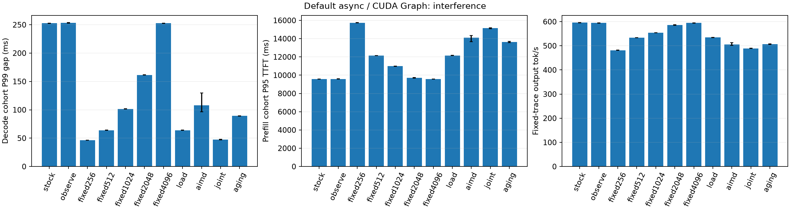
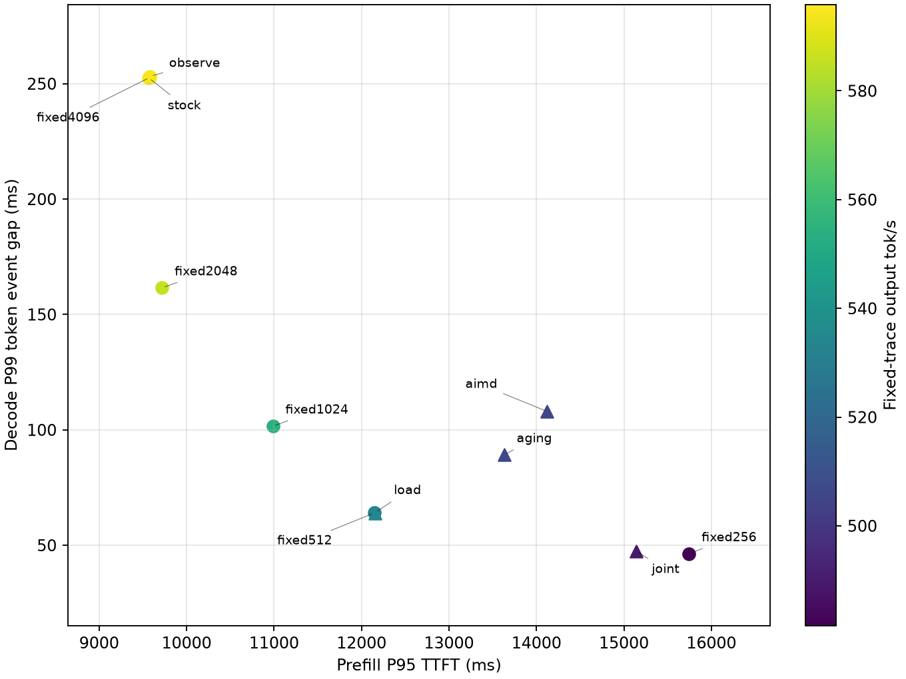
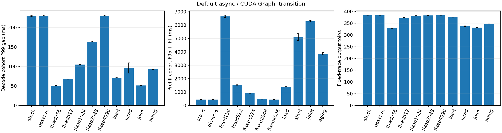
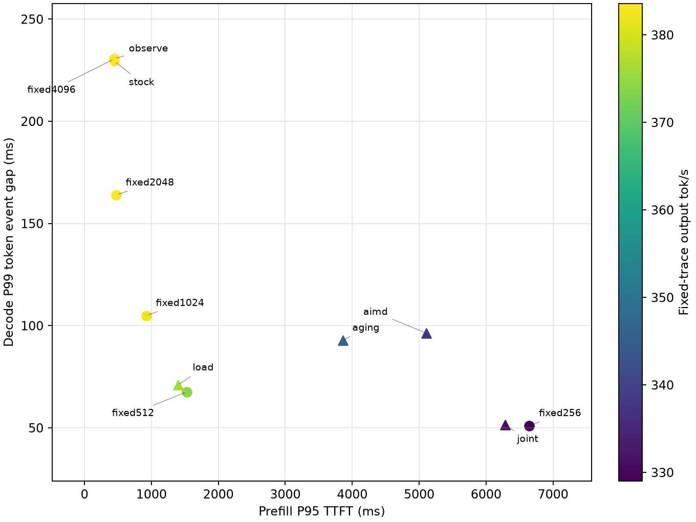
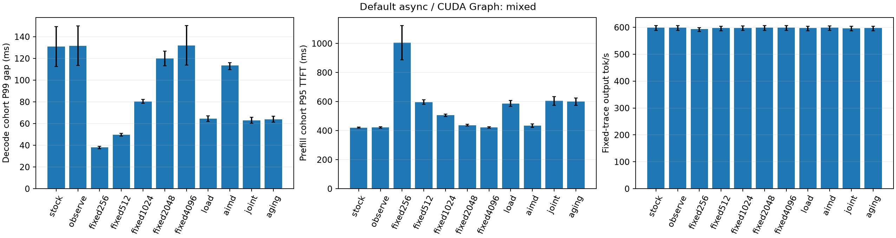
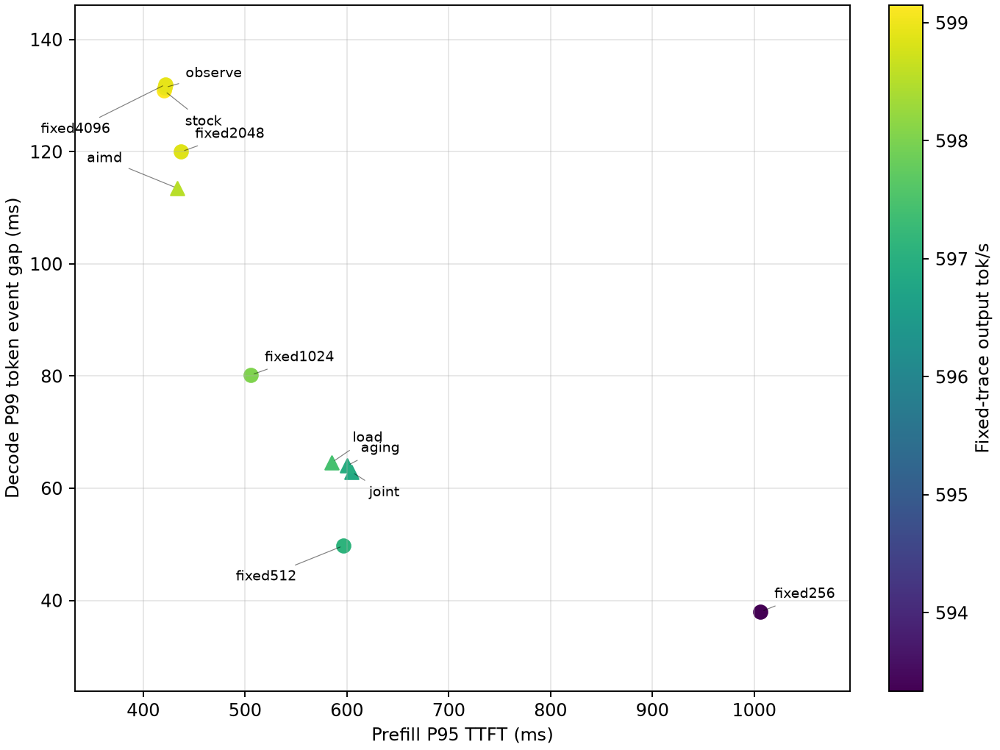
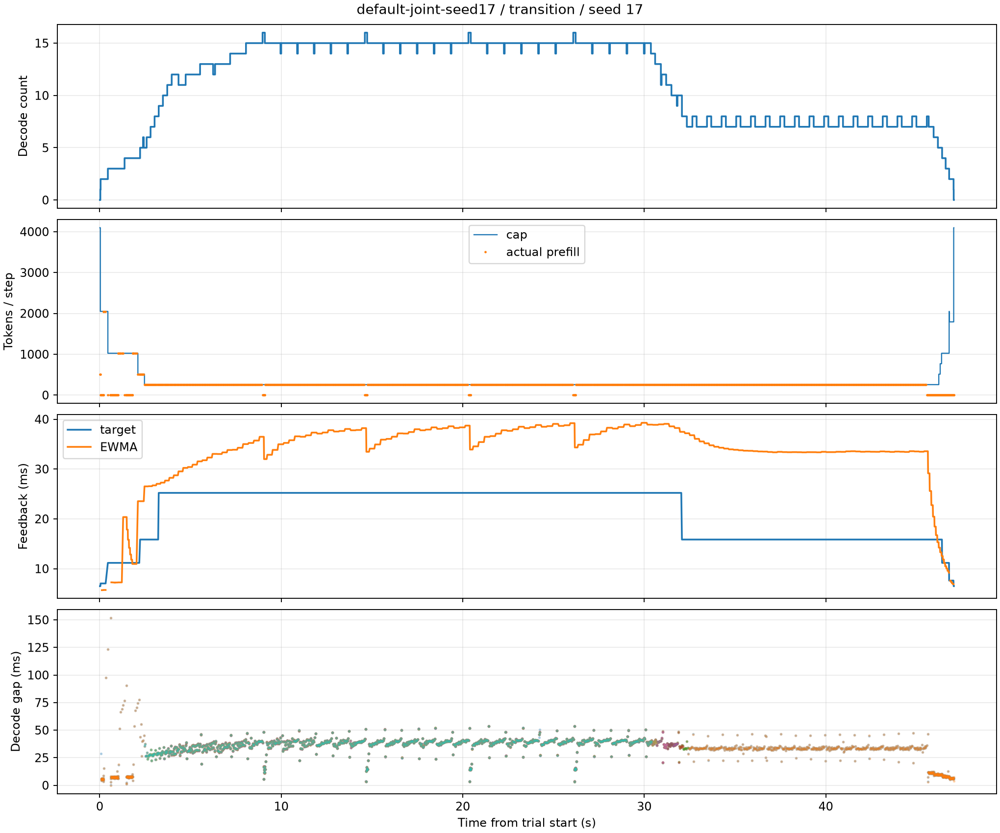
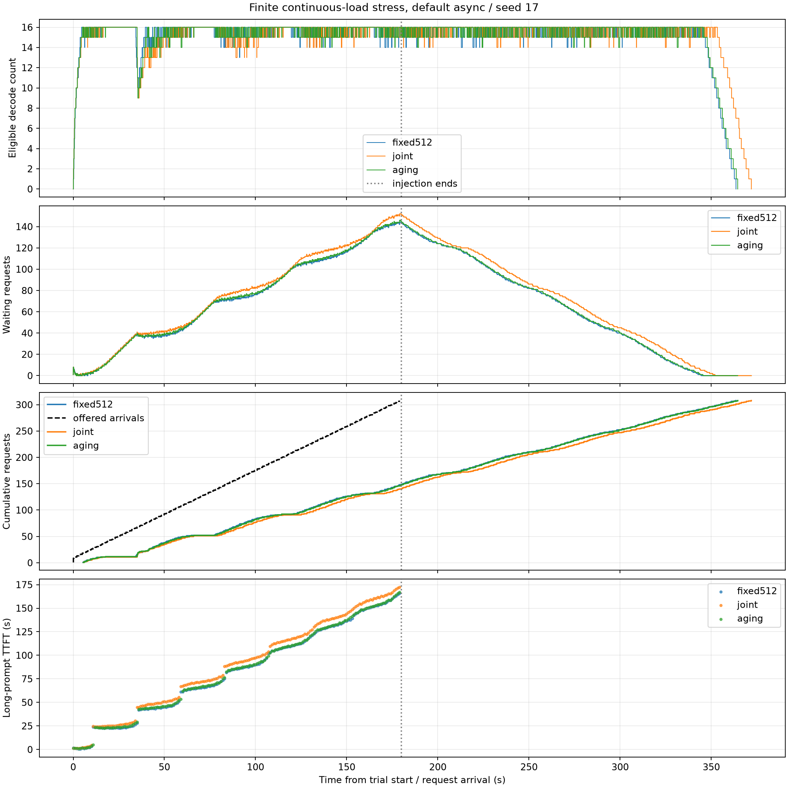

# 动态 Prefill Budget 调度：完整实验报告

更新：2026-10-20T08:27:45+08:00。

已审计421个Trial、192个Session，主矩阵165个Trial（11策略×3场景×5独立种子服务）。全部主矩阵重复达到5次。

**核心结论：** 独立新种子验证的2048/4096均衡档，在干扰场景Decode P99降低35.85%，Prefill P95增加1.72%，固定Trace吞吐下降1.72%；压力切换场景也有稳定收益。mixed的P99区间跨零。默认复杂反馈策略未优于最佳静态预算，修正档与Fixed-2048的P99差异不显著。项目实现与研究评估完成，优化目标按场景分别判断。

## 1. 项目与实现

在vLLM V1原生Scheduler上增加每Step共享Prefill/Replay计算配额。Running与Waiting共享余额，KV分配成功后扣减，撤销时退款；普通Decode预留Token机会。全局4096 Token上限、原生KV管理、请求次序与模型Kernel保持原有职责。

实现Fixed、Decode数量分档Load、完成反馈EWMA/AIMD、Load+AIMD（joint）、有界Aging。反馈在update_from_output处理已接受输出后获取，提交与完成Ledger分离，没有为在线控制增加CUDA同步或Future等待。

源码与入口：[运行说明](../docs/RUNNING.md)、[问题与处理记录](../docs/IMPLEMENTATION_LOG.md)、[固定版本调度补丁](../patches/v0.32.0/scheduler.patch)。主实现位于apb/controller.py与apb/runtime.py。配置通过APB_CONFIG JSON接入，并由Benchmark保存完整参数。

## 2. 环境与可复现性

| 项目 | 实测设置 |
| --- | --- |
| GPU | RTX 3090 24 GiB，驱动570.86.15 |
| 模型 | 本地Qwen3-1.7B，FP16；Revision 70d244cc86ccca08cf5af4e1e306ecf908b1ad5e |
| 软件 | vLLM 0.32.0+cu129，Torch 2.13.0+cu129，CUDA Runtime 12.9，Python 3.11.16 |
| 主配置 | max_model_len=8192，max_num_seqs=16，两个全局Token预算均4096 |
| KV | 8192×16=131072 Token；FP16理论KV容量14 GiB |
| 执行路径 | 正式：原生Async/CUDA Graph；机制：Sync/Eager；FLASH_ATTN backend |
| 主线开关 | Prefix Cache、Spec、LoRA、KV Offload关闭，stream_interval=1 |
| 正式混合RPS | 2.422 |
| 代码冻结检查 | 全部Hash匹配 |

已复制独立stock/candidate Python源码，二进制复用未修改官方wheel。模型分片完整SHA256记录、实际CLI、有效配置、源码Hash、Trace Hash与请求Token事件均保留。大数据根目录：`/mnt/ondeviceinfer/experiments/adaptive_prefill_budget_v0320`。

每策略/种子独立启动正式服务，在同一服务内依次执行已排空的三个场景；各种子轮随机化策略顺序。验证种子829与负载校准种子853均不参与正式种子17/29/43/71/101。冷启动/编译/预热不进入主性能窗口。

## 3. 负载与指标口径

| 场景 | 固定请求定义 |
| --- | --- |
| interference | 8个512输入/1024输出Decode cohort；0.4秒后注入24个6144输入/128输出请求 |
| transition | 2个长输出请求+2秒后8个Decode请求；50个长Prompt按0.8秒间隔持续注入至39.4秒 |
| mixed | 200请求，输入512/2048/6144，输出128/256/512；共同开放环2.422 RPS |
| starvation | 180秒注入：每秒一个6144输入请求，每1.5秒补充一个2048输入/2048输出请求；停止注入后排空 |

客户端ITL定义为同请求相邻有效输出Token事件的接收间隔。保存每个事件Token IDs并检查一事件是否一Token；若多Token，指标标为Chunk Gap，不能均摊成逐Token间隔。服务端完成间隔独立统计，包含主机处理，不称为GPU Kernel耗时。

interference/transition的Decode指标使用初始Decode cohort，TTFT使用注入Prefill cohort；mixed使用全请求。新Prefill完成后也参与在线Decode计数。吞吐为同一固定Trace全部输出Token/makespan，不能用其证明最大服务容量。

## 4. 静态参照选择

在独立验证集上预先采用Prefill P95 TTFT增幅≤10%、固定Trace吞吐降幅≤5%的约束，再选Decode P99最小的固定Cap。选择结果：**fixed2048**。完整静态Pareto曲线同时保留；不只与大预算原生基线比较。

| 策略 | 验证Decode P99 ms | 验证Prefill P95 TTFT ms | 验证tok/s | 满足约束 |
| --- | --- | --- | --- | --- |
| fixed256 | 45.73 | 15751.91 | 481.52 | False |
| fixed512 | 63.92 | 12137.93 | 534.03 | False |
| fixed1024 | 101.16 | 10957.11 | 554.57 | False |
| fixed2048 | 160.85 | 9693.38 | 586.58 | True |
| fixed4096 | 252.50 | 9544.33 | 595.30 | True |

## 5. 默认部署路径正式结果

### interference

| 策略 | 重复 | Decode P95 ms | Decode P99 ms | Prefill Mean TTFT ms | Prefill P95 TTFT ms | Output tok/s |
| --- | --- | --- | --- | --- | --- | --- |
| stock | 5 | 15.59 | 252.54 | 5101.26 | 9568.50 | 595.84 |
| observe | 5 | 16.01 | 253.20 | 5107.22 | 9584.20 | 594.28 |
| fixed256 | 5 | 36.92 | 46.28 | 8352.74 | 15744.84 | 481.67 |
| fixed512 | 5 | 54.54 | 64.03 | 6424.47 | 12150.89 | 533.70 |
| fixed1024 | 5 | 85.68 | 101.61 | 5843.48 | 10986.09 | 553.96 |
| fixed2048 | 5 | 115.11 | 161.53 | 5184.75 | 9720.03 | 586.00 |
| fixed4096 | 5 | 16.51 | 252.73 | 5106.91 | 9580.83 | 594.39 |
| load | 5 | 54.68 | 64.02 | 6425.22 | 12153.72 | 534.35 |
| aimd | 5 | 43.23 | 108.00 | 6941.06 | 14122.22 | 505.69 |
| joint | 5 | 40.64 | 47.56 | 7789.57 | 15138.78 | 489.29 |
| aging | 5 | 50.45 | 89.20 | 7041.80 | 13629.82 | 506.45 |

### transition

| 策略 | 重复 | Decode P95 ms | Decode P99 ms | Prefill Mean TTFT ms | Prefill P95 TTFT ms | Output tok/s |
| --- | --- | --- | --- | --- | --- | --- |
| stock | 5 | 164.29 | 229.50 | 432.73 | 445.74 | 383.57 |
| observe | 5 | 164.37 | 230.65 | 433.30 | 445.80 | 383.52 |
| fixed256 | 5 | 42.57 | 51.01 | 4862.42 | 6646.54 | 329.04 |
| fixed512 | 5 | 58.38 | 67.63 | 1030.29 | 1529.85 | 373.85 |
| fixed1024 | 5 | 90.27 | 104.91 | 568.94 | 921.44 | 382.42 |
| fixed2048 | 5 | 136.80 | 163.86 | 455.34 | 471.33 | 383.36 |
| fixed4096 | 5 | 163.82 | 230.51 | 433.05 | 445.87 | 383.53 |
| load | 5 | 61.79 | 71.00 | 928.16 | 1399.28 | 375.98 |
| aimd | 5 | 46.81 | 96.43 | 3301.80 | 5103.50 | 337.25 |
| joint | 5 | 42.78 | 51.41 | 4515.63 | 6283.08 | 331.05 |
| aging | 5 | 82.15 | 92.81 | 2700.21 | 3857.20 | 346.60 |

### mixed

| 策略 | 重复 | Decode P95 ms | Decode P99 ms | Prefill Mean TTFT ms | Prefill P95 TTFT ms | Output tok/s |
| --- | --- | --- | --- | --- | --- | --- |
| stock | 5 | 17.90 | 130.89 | 149.51 | 420.66 | 599.15 |
| observe | 5 | 18.02 | 131.43 | 150.10 | 421.12 | 598.98 |
| fixed256 | 5 | 33.94 | 37.98 | 376.86 | 1006.26 | 593.34 |
| fixed512 | 5 | 42.83 | 49.76 | 214.02 | 596.69 | 597.10 |
| fixed1024 | 5 | 36.84 | 80.18 | 178.68 | 505.69 | 598.02 |
| fixed2048 | 5 | 18.71 | 120.00 | 153.21 | 437.31 | 598.86 |
| fixed4096 | 5 | 17.90 | 132.02 | 150.18 | 422.18 | 598.92 |
| load | 5 | 43.63 | 64.60 | 201.88 | 585.18 | 597.44 |
| aimd | 5 | 20.84 | 113.50 | 159.46 | 433.35 | 598.53 |
| joint | 5 | 42.76 | 62.91 | 215.01 | 604.67 | 596.84 |
| aging | 5 | 42.90 | 64.00 | 210.61 | 600.02 | 596.95 |

## 6. 配对收益与不确定性

下表为相同种子配对相对变化的均值及95% bootstrap区间；负号表示指标降低。每Token不作为独立重复。5次重复仍有限，跨模型/GPU不能直接外推。

### 相对 stock

| 场景 | 策略 | 指标 | 配对数 | 变化% | 95%区间% |
| --- | --- | --- | --- | --- | --- |
| interference | load | decode99 | 5 | -74.65 | [-74.78, -74.53] |
| interference | load | prefill95 | 5 | 27.02 | [26.85, 27.29] |
| interference | load | output_tok_s | 5 | -10.32 | [-10.42, -10.25] |
| interference | joint | decode99 | 5 | -81.17 | [-81.34, -81.00] |
| interference | joint | prefill95 | 5 | 58.21 | [57.85, 58.62] |
| interference | joint | output_tok_s | 5 | -17.88 | [-18.01, -17.76] |
| interference | aging | decode99 | 5 | -64.68 | [-64.88, -64.48] |
| interference | aging | prefill95 | 5 | 42.45 | [41.63, 43.13] |
| interference | aging | output_tok_s | 5 | -15.00 | [-15.19, -14.86] |
| transition | load | decode99 | 5 | -69.06 | [-69.25, -68.90] |
| transition | load | prefill95 | 5 | 213.93 | [212.02, 215.77] |
| transition | load | output_tok_s | 5 | -1.98 | [-2.06, -1.90] |
| transition | joint | decode99 | 5 | -77.60 | [-77.80, -77.40] |
| transition | joint | prefill95 | 5 | 1309.69 | [1291.83, 1330.00] |
| transition | joint | output_tok_s | 5 | -13.69 | [-13.84, -13.55] |
| transition | aging | decode99 | 5 | -59.56 | [-59.75, -59.34] |
| transition | aging | prefill95 | 5 | 765.38 | [749.05, 785.71] |
| transition | aging | output_tok_s | 5 | -9.64 | [-9.80, -9.51] |
| mixed | load | decode99 | 5 | -49.25 | [-57.27, -42.10] |
| mixed | load | prefill95 | 5 | 39.07 | [35.40, 43.20] |
| mixed | load | output_tok_s | 5 | -0.28 | [-0.43, -0.16] |
| mixed | joint | decode99 | 5 | -50.55 | [-58.20, -43.27] |
| mixed | joint | prefill95 | 5 | 43.70 | [37.18, 49.90] |
| mixed | joint | output_tok_s | 5 | -0.38 | [-0.66, -0.20] |
| mixed | aging | decode99 | 5 | -49.64 | [-57.52, -41.76] |
| mixed | aging | prefill95 | 5 | 42.60 | [36.76, 47.71] |
| mixed | aging | output_tok_s | 5 | -0.36 | [-0.55, -0.22] |

### 相对 fixed2048

| 场景 | 策略 | 指标 | 配对数 | 变化% | 95%区间% |
| --- | --- | --- | --- | --- | --- |
| interference | load | decode99 | 5 | -60.37 | [-60.54, -60.19] |
| interference | load | prefill95 | 5 | 25.04 | [24.68, 25.33] |
| interference | load | output_tok_s | 5 | -8.81 | [-8.94, -8.65] |
| interference | joint | decode99 | 5 | -70.56 | [-70.80, -70.34] |
| interference | joint | prefill95 | 5 | 55.75 | [55.13, 56.33] |
| interference | joint | output_tok_s | 5 | -16.50 | [-16.69, -16.26] |
| interference | aging | decode99 | 5 | -44.78 | [-45.15, -44.40] |
| interference | aging | prefill95 | 5 | 40.23 | [39.35, 40.92] |
| interference | aging | output_tok_s | 5 | -13.58 | [-13.77, -13.39] |
| transition | load | decode99 | 5 | -56.67 | [-56.98, -56.38] |
| transition | load | prefill95 | 5 | 196.91 | [193.80, 200.06] |
| transition | load | output_tok_s | 5 | -1.93 | [-2.01, -1.84] |
| transition | joint | decode99 | 5 | -68.63 | [-68.88, -68.33] |
| transition | joint | prefill95 | 5 | 1233.25 | [1209.36, 1251.81] |
| transition | joint | output_tok_s | 5 | -13.65 | [-13.79, -13.50] |
| transition | aging | decode99 | 5 | -43.36 | [-43.67, -43.06] |
| transition | aging | prefill95 | 5 | 718.27 | [709.59, 728.88] |
| transition | aging | output_tok_s | 5 | -9.59 | [-9.74, -9.46] |
| mixed | load | decode99 | 5 | -45.89 | [-50.44, -41.64] |
| mixed | load | prefill95 | 5 | 33.77 | [30.38, 37.91] |
| mixed | load | output_tok_s | 5 | -0.24 | [-0.38, -0.10] |
| mixed | joint | decode99 | 5 | -47.30 | [-51.53, -42.52] |
| mixed | joint | prefill95 | 5 | 38.21 | [32.55, 43.87] |
| mixed | joint | output_tok_s | 5 | -0.33 | [-0.61, -0.14] |
| mixed | aging | decode99 | 5 | -46.37 | [-50.67, -41.81] |
| mixed | aging | prefill95 | 5 | 37.16 | [32.26, 41.77] |
| mixed | aging | output_tok_s | 5 | -0.32 | [-0.51, -0.17] |

## 7. 正确性与兼容性

22项纯控制器/真实Scheduler与KV Manager回归通过，覆盖共享配额、Decode机会、尾块、分配失败、缓存命中、取消、重算、两轮在途与stock/off状态一致性。原始日志：`/mnt/ondeviceinfer/experiments/adaptive_prefill_budget_v0320/logs/tests-final-22.log`。

审计发现错误数：0。正式主线原生抢占总数：0.0。所有主线SSE事件均为单Token：False。

取消、Prefix Cache及人为小KV容量抢占压力是独立兼容性组，不加入性能主表。自然语言用例核对逐Token输出；它只覆盖有限问答，不代表完整任务质量评测或所有数值bitwise一致。

## 8. 饥饿压力与参数消融

### mechanism

| 路径 | 场景/配置 | 策略 | 重复 | P99 ms | P95 TTFT ms | Output tok/s | 抢占数 |
| --- | --- | --- | --- | --- | --- | --- | --- |
| eager | interference | fixed512 | 5 | 71.70 | 14423.43 | 347.54 | 0.0 |
| eager | interference | joint | 5 | 53.68 | 17880.40 | 341.75 | 0.0 |
| eager | interference | stock | 5 | 260.79 | 11668.16 | 358.36 | 0.0 |

### starvation

| 路径 | 场景/配置 | 策略 | 重复 | P99 ms | P95 TTFT ms | Output tok/s | 抢占数 |
| --- | --- | --- | --- | --- | --- | --- | --- |
| default | starvation | aging | 5 | 80.23 | 155846.87 | 781.10 | 0.0 |
| default | starvation | fixed512 | 5 | 59.41 | 154591.46 | 784.11 | 0.0 |
| default | starvation | joint | 5 | 57.85 | 162457.33 | 767.92 | 0.0 |

### native

| 路径 | 场景/配置 | 策略 | 重复 | P99 ms | P95 TTFT ms | Output tok/s | 抢占数 |
| --- | --- | --- | --- | --- | --- | --- | --- |
| default | interference | default-stock-th1024-a0 | 5 | 219.89 | 9901.16 | 588.88 | 0.0 |
| default | interference | default-stock-th1024-a1 | 5 | 220.05 | 9891.42 | 589.21 | 0.0 |
| default | interference | default-stock-th512-a0 | 5 | 201.72 | 10176.12 | 590.49 | 0.0 |
| default | mixed | default-stock-th1024-a0 | 5 | 79.56 | 502.34 | 598.18 | 0.0 |
| default | mixed | default-stock-th1024-a1 | 5 | 79.50 | 501.96 | 598.19 | 0.0 |
| default | mixed | default-stock-th512-a0 | 5 | 52.25 | 631.84 | 597.46 | 0.0 |

### native2048

| 路径 | 场景/配置 | 策略 | 重复 | P99 ms | P95 TTFT ms | Output tok/s | 抢占数 |
| --- | --- | --- | --- | --- | --- | --- | --- |
| default | interference | default-stock-th2048-a0 | 5 | 255.41 | 9684.65 | 594.20 | 0.0 |
| default | mixed | default-stock-th2048-a0 | 5 | 118.99 | 434.22 | 599.02 | 0.0 |

### ablation

| 路径 | 场景/配置 | 策略 | 重复 | P99 ms | P95 TTFT ms | Output tok/s | 抢占数 |
| --- | --- | --- | --- | --- | --- | --- | --- |
| default | interference | default-aging-aging-every-step | 3 | 101.04 | 10971.88 | 551.70 | 0.0 |
| default | interference | default-fixed4096-reserve-off | 3 | 252.46 | 9553.55 | 595.03 | 0.0 |
| default | interference | default-fixed512-idle-relax | 3 | 64.03 | 12111.61 | 534.80 | 0.0 |
| default | interference | default-joint-ema01 | 3 | 51.33 | 14759.47 | 496.73 | 0.0 |
| default | interference | default-joint-ema04 | 3 | 46.59 | 15327.33 | 487.57 | 0.0 |
| default | interference | default-joint-k1 | 3 | 46.63 | 15676.17 | 484.26 | 0.0 |
| default | interference | default-joint-k16 | 3 | 53.73 | 14579.78 | 500.00 | 0.0 |
| default | interference | default-joint-k4 | 3 | 47.04 | 15404.45 | 486.82 | 0.0 |
| default | interference | default-joint-min1024 | 3 | 101.33 | 10963.39 | 554.90 | 0.0 |
| default | interference | default-joint-min512 | 3 | 63.86 | 12128.12 | 534.89 | 0.0 |
| default | interference | default-joint-rho01 | 3 | 48.45 | 15126.13 | 489.56 | 0.0 |
| default | interference | default-joint-rho03 | 3 | 48.26 | 14990.01 | 491.59 | 0.0 |

### compatibility

| 路径 | 场景/配置 | 策略 | 重复 | P99 ms | P95 TTFT ms | Output tok/s | 抢占数 |
| --- | --- | --- | --- | --- | --- | --- | --- |
| default | cache | aging | 1 | 9.23 | 362.88 | 19.34 | 0.0 |
| default | cache | fixed512 | 1 | 7.24 | 442.42 | 19.17 | 0.0 |
| default | cache | off | 1 | 7.32 | 362.50 | 19.34 | 0.0 |
| default | cache | stock | 1 | 7.26 | 363.92 | 19.33 | 0.0 |
| default | correctness | aging | 1 | 16.11 | 442.11 | 412.82 | 0.0 |
| default | correctness | fixed512 | 1 | 38.09 | 528.43 | 373.13 | 0.0 |
| default | correctness | off | 1 | 9.78 | 435.06 | 416.72 | 0.0 |
| default | correctness | stock | 1 | 10.74 | 432.07 | 415.55 | 0.0 |
| default | pressure | aging | 1 | 54.10 | 9157.45 | 320.92 | 115.0 |
| eager | cache | aging | 1 | 30.00 | 371.43 | 16.79 | 0.0 |
| eager | cache | fixed512 | 1 | 24.43 | 506.77 | 16.62 | 0.0 |
| eager | cache | off | 1 | 23.45 | 373.08 | 16.86 | 0.0 |
| eager | cache | stock | 1 | 23.88 | 369.39 | 16.85 | 0.0 |
| eager | correctness | aging | 1 | 74.23 | 600.44 | 223.59 | 0.0 |
| eager | correctness | fixed512 | 1 | 49.47 | 634.62 | 219.88 | 0.0 |
| eager | correctness | off | 1 | 231.32 | 465.21 | 259.58 | 0.0 |
| eager | correctness | stock | 1 | 234.63 | 461.08 | 261.04 | 0.0 |
| eager | pressure | aging | 1 | 62.38 | 13629.12 | 207.67 | 106.0 |

### idle

| 路径 | 场景/配置 | 策略 | 重复 | P99 ms | P95 TTFT ms | Output tok/s | 抢占数 |
| --- | --- | --- | --- | --- | --- | --- | --- |
| default | prefill | fixed512 | 1 | 7.91 | 489.76 | 28.20 | 0.0 |
| default | prefill | joint | 1 | 7.57 | 407.14 | 28.26 | 0.0 |
| default | prefill | stock | 1 | 6.91 | 394.52 | 28.28 | 0.0 |

### balanced

| 路径 | 场景/配置 | 策略 | 重复 | P99 ms | P95 TTFT ms | Output tok/s | 抢占数 |
| --- | --- | --- | --- | --- | --- | --- | --- |
| default | interference | fixed2048 | 5 | 161.36 | 9723.30 | 585.83 | 0.0 |
| default | interference | joint | 5 | 161.62 | 9716.89 | 586.13 | 0.0 |
| default | interference | stock | 5 | 251.96 | 9552.84 | 596.40 | 0.0 |
| default | mixed | fixed2048 | 5 | 118.60 | 436.63 | 597.79 | 0.0 |
| default | mixed | joint | 5 | 118.40 | 436.61 | 597.83 | 0.0 |
| default | mixed | stock | 5 | 124.04 | 421.38 | 597.95 | 0.0 |
| default | transition | fixed2048 | 5 | 164.12 | 470.74 | 383.38 | 0.0 |
| default | transition | joint | 5 | 163.80 | 469.24 | 383.39 | 0.0 |
| default | transition | stock | 5 | 229.63 | 443.48 | 383.59 | 0.0 |

## 9. 遇到的问题与解决过程

日期：2026-10-20。此文件记录实际发生的问题；最终报告引用对应日志和结果。

| 问题 | 发现方式 | 处理与验证 |
| --- | --- | --- |
| 精确补丁锚点只匹配缩进时，Running 与 Waiting 两处被同时识别 | prepare首次运行主动拒绝，未修改原环境 | 为每个锚点加行首边界，并对源码Hash与唯一匹配做断言 |
| 真实Scheduler测试需要设置cache_config.num_gpu_blocks | 初版8个测试在构造时失败 | 补齐真实缓存配置；不跳过原生构造断言 |
| 取消后Request已从requests移除，测试模拟器仍访问它 | 取消回归KeyError | 模拟器对已取消请求返回空结果，再让原生完成处理释放在途状态 |
| Native Request.arrival_time使用Unix时间 | 代码审查与新增500ms等待用例 | 等待年龄改用同一时基；完成与输出间隔继续用单调时钟 |
| 独立Prefix Cache测试未初始化NONE_HASH | 缓存命中回归NameError | 调用原生init_none_hash后测试真实缓存命中，不绕过Hash/KV逻辑 |
| 带Replay尾部Decode的分配可能多占一枚预留Token | 预算边界审查 | 只要分配包含Prefill/Replay，整个连续候选区间都先受剩余配额与Decode预留限制，尾部Decode可在下一步推进 |
| 原始纯Decode参考开始阶段仍可能包含其他请求的Prefill | 基线校准日志出现首段高尾延迟 | 标定只使用实际Prompt/Replay均为零、全部N个Decode都有有效样本的8步窗口 |

实现与设计的明确调整：每个策略/执行路径使用新服务，服务内部复用已排空的种子和场景试验，以减少重复模型加载；Prefix Cache主线关闭，记录此差异，不将其称为“每个trial新服务”。纯决策状态与时间样本有界；详细日志由后台批量写入，审计检查丢失与未完成Step。

API实际将传入的请求ID扩展为`cmpl-{user_id}-0-{suffix}`。服务端/客户端关联时显式归一化前缀并验证后缀边界；若只做原始ID直接比较会得到空的cohort样本。原始ID全部保留，避免通过时间近似匹配。

第一次observe GPU Pilot正常完成请求，但关停时原生默认`shutdown_timeout=0`采用立即abort，管理器在Scheduler关闭日志前强杀EngineCore，末尾遥测和summary未落盘。审计因此拒绝该批次。原始产物保存在`raw/failures/eager-observe-abort`；所有后续组统一设置`--shutdown-timeout 20`，重跑该Pilot，不能通过补写summary使失败记录伪装通过。

后续标定增加N=16与6144上下文档位，并记录目标表范围外的请求。正式实验每个策略/种子单独启动服务，在同一服务内测三个已排空场景；各种子轮内随机化策略顺序。Pilot中在服务内复用多个种子/标定档仅用于开发与选型，不冒充独立启动的正式重复。

饥饿压力Trace改为180秒开放环：每秒一个6144Token Prefill，加每1.5秒一个2048输出Token请求。原先每4秒补充一个1024输出请求，首批长Decode结束后无法保持足够高的Decode数量，因此不能声称验证了持续高压。正式日志以实际Decode数量证明压力，而不是按注入计划推断。

GPU兼容性另设640 Blocks、关闭完整输入长度预留的专用压力场景，触发原生抢占/恢复，避免只在CPU模拟器上验证Replay。该组主动改变KV容量与准入配置，严格排除在性能主表之外。

正式混合流量在冻结前另跑原生200请求、4 RPS的开放环校准，以该有限Trace完成RPS的80%选共同正式到达率，并明确这只是保守负载选择，不是最大稳定容量估计。若策略在该共同到达率下仍积压，队列与排空代价保留，不作为稳定系统吞吐收益。

Pilot时间线发现原压力切换Trace的Prefill注入在7.2秒就结束，Decode压力下降后已无新Prefill，无法评估低压恢复时扩大预算的实际价值。冻结前将正式transition改为50个长Prompt、0.8秒间隔，注入持续至39.4秒；原Pilot数据保留为开发用突发场景，与新Trace正式结果分开。

复现流程审查中补强了来源保护：重复freeze只有Hash完全一致时才幂等返回，禁止覆盖已有正式来源快照；原始数据审计同时核对各Session保存的在线代码Hash。报告与分析脚本可以更新，在线调度、请求生成与标定表的12项冻结输入保持不变。

前三个正式种子的Joint均大量停留在256配额下限，Decode尾延迟改善伴随Prefill排队和固定Trace吞吐退化。因此增加独立的`balanced`配置修正实验：预算下限取自既有独立验证集选中的2048，不修改控制器或主矩阵，冻结五个新种子做单独验证。该组属于观察结果后的工程修正，不包装为事先指定的确认性主结果。原配置和所有负结果继续保留。

兼容性实验发现当前API的usage不返回prompt_tokens_details.cached_tokens。将缺失值按0处理会误判缓存未命中。离线分析改为同时保留usage缺失状态、Prometheus prefix_cache_hits_total/queries_total增量、候选Scheduler实际Prompt计算量及首次计算位置；缓存场景要求“实际Prompt计算+命中Token=输入Token总数”。默认Aging缓存组已通过该对账。

默认Async/Graph的patched-off在17Token合成输入的第18个输出出现一次与stock不同的续写；前17个输出相同，所有自然问答及长度检查通过。此差异原始数据保留，另安排stock/off各两次新服务重复、对齐公共前缀的teacher-forced和自回归Top-20 logprob诊断，不能未经核查就归因于浮点误差。该诊断独立于性能矩阵，最终解释以实际探测记录为准。

数值诊断的两次全新stock服务均在同一合成用例、同一第18个Token复现原off续写分支；共同前17个输出不变。Top-20检查中“ involving”与“ a”的logprob差约0.015625–0.03125，off与stock均表现为接近候选。四次诊断均保留原始响应与logprobs，原始兼容性结果不覆盖。该证据支持原生批次/数值敏感性，输出完全一致不作为FP16异步服务的通用保证；有限自然任务仍一致。

Nsight本机默认cuda-graph-trace=graph，逐Kernel表不含图内节点。保留五策略整体图采集，并增加一个显式node粒度Joint诊断，避免以图外Kernel统计冒充完整模型Kernel统计。所有Profile均独立于性能主表，采集本身的时延扰动不计入优化收益。

复核Joint的128步窗口发现其中没有GPU图活动或非零Graph节点ID，不能将它称为图内算子验证。随后选择实际有图活动的observe补充节点采集：得到48228个Kernel活动，其中41975个带Graph节点ID，补齐图内覆盖证据。Joint窗口有41393个Kernel但无图内ID；不同策略窗口内的Prefill进度和Step组成不同，不能将这些数量或累计GPU时间的比值当作性能收益。

## 10. 性能不及预期的优化与原因

本报告区分实现验收、调度权衡和优化目标。共享 Prefill/Replay 配额确实能降低既有 Decode 请求受到的干扰；本机默认 Joint/AIMD/Aging 没有优于独立验证所选的 Fixed-2048。配置修正后，在干扰与压力切换场景达到预先保留的均衡约束；mixed 的尾延迟改善证据不足。

### 原始五种子结果与代价

正式种子为 17/29/43/71/101。interference 原生 Decode P99 为 252.54 ms，Load 为 64.02 ms，Joint 为 47.56 ms。Load 的配对 P99 变化为 **−74.65%**，95% 区间 [−74.78%, −74.53%]；同时 Prefill P95 TTFT 增加 **27.02%**、固定 Trace 输出吞吐下降 **10.32%**。这些代价超出 TTFT 增幅≤10%、吞吐降幅≤5% 的均衡边界。

Joint 的 Prefill P95 TTFT 为 15,138.78 ms，原生为 9,568.50 ms；输出吞吐为 489.29 tok/s，原生为 595.84 tok/s。只报告 P99 降幅会掩盖明显的排队与吞吐代价。相对同一批测试中的 Fixed-2048，Load 的 P99 下降 60.37%，但 Prefill P95 增加 25.04%、吞吐下降 8.81%，仍不满足均衡约束。

同步 Eager 的五次机制重复也复现了权衡：stock / Fixed-512 / Joint 的 Decode P99 均值为 260.79 / 71.70 / 53.68 ms，Prefill P95 为 11,668.16 / 14,423.43 / 17,880.40 ms。默认 Async/Graph 的结果必须独立评价，不能把两条执行路径的数值混合成收益。

### 反馈为什么压到下限

Joint 在实际含 Prefill 计算的步骤中，interference 平均 **90.31%**、transition 平均 **97.95%** 处于最小 256 配额。对应服务端 Token 间隔超过标定目标的比例约为 61.54%、89.34%。这里的目标是纯 Decode 参考窗口 P90 的 1.2 倍，评价指标则包含客户端 P99，二者不是同一个统计量。

在本机模型上，即使 256 Token 的 Mixed Step，也经常无法达到该相对纯 Decode 目标。控制器继续减小预算受到下限限制，随后主要表现为长期停留在最小值。提高反馈频率或改变平滑系数无法消除这个可行性问题。

6144 Token 的 Prompt 在 256 配额下理论上需要 24 次推进，在 2048 下需要 3 次；共享配额、尾块和无 Decode 放宽使实际次数有所变化。更多前向步骤增加每个 Prompt 的累计成本，并让后续请求排队。Joint 的 Prefill 首次调度前排队 P95，在 interference / transition 的五次均值约为 **14,238.74 / 5,421.82 ms**。分位数不能相加，这些数值用于定位排队代价，并非可加的 TTFT 分解。

下面的正式 transition 时间线同时展示实际 Decode 数、选择配额、实际 Prefill 量、反馈与目标。预算在大部分有用 Prefill 阶段保持 256；扩大预算主要出现在尾部，无法追回此前积压。实际 Decode 数由调度结果共同决定，不能仅按计划注入时刻将每个策略都称为同样的低压/高压阶段。

时间线仍有早期超过 100 ms 的瞬态间隔。P99 改善不构成每个 Token 的硬时延上界，已经提交的 Chunk 也无法被后续反馈撤销。

### 不及预期的方案与已验证修正

以下单因素变化使用与默认配置相同的 17/29/43 三个种子配对，完整区间保存在 `reports/additional_comparisons.json`。没有将各项局部最优拼接后当成已验证组合。

| 修改 | 配对参照 | Decode P99 变化 | Prefill P95 变化 | 输出 tok/s 变化 | 解释 |
| --- | --- | ---: | ---: | ---: | --- |
| Joint minimum=512 | 默认 Joint | +33.29% | −19.78% | +9.26% | 恢复 Prefill 进度，付出尾延迟代价 |
| Joint minimum=1024 | 默认 Joint | +111.50% | −27.48% | +13.35% | 更接近固定中等预算的权衡 |
| Joint alpha=0.1 | 默认 Joint | +7.14% | −2.38% | +1.47% | 平滑调整带来小幅取舍，未修复根因 |
| Aging 每步允许救援 | 默认 Aging | +13.10% | −19.57% | +8.88% | 更频繁放宽预算会增加 Decode 干扰 |
| F4096 关闭 Decode 预留 | F4096 | −0.13% | −0.29% | +0.11% | P99 区间跨零，本负载中影响很小 |

Load 在高 Decode 数阶段接近 Fixed-512；默认 Aging 在 interference 与 transition 的三项均值均差于 Fixed-512。延迟反馈与救援的复杂度没有自动带来更好的 Pareto 点。Decode 预留的价值已由队首 Partial Prefill 的真实 Scheduler 回归验证；自然 Trace 中旧 Decode 通常先遍历，不能把主要性能收益归因于预留开关。

原生 long-prefill threshold 也具有竞争力：原五种子 mixed 中，原生 512 阈值 P99 为 52.25 ms，Load 为 64.60 ms；其 Prefill P95 为 631.84 ms，Load 为 585.18 ms。它们仍是不同的延迟取舍。原生阈值限制单请求，项目限制整步合计；同时有多个 Partial Prefill 时行为不同，不能互相等同。原生 512/1024/2048 及自适应阈值的完整结果列在主报告第 8 节。

### 修正配置：独立五种子验证

修正采用独立验证集原已选出的 2048 作为下限，在线实现保持冻结。新种子为 **151/163/179/191/211**，每种子重新启动 stock、Fixed-2048 和 Joint-min2048 三个服务，轮内随机化顺序。此阶段在观察原主矩阵后登记，属于工程修正验证，独立于原 165 个确认性 Trial。

该配置的有效行为是：**有 Decode 时为 2048，无 Decode 时为 4096**。当前 Load 分档最高为 2048，所以设置此下限后，AIMD 不再影响有 Decode 时的有效配额。它是保守的两档回退，不能据此证明复杂反馈算法的增量价值。配置见 [balanced.json](../configs/presets/balanced.json)。

| 场景 | stock P99 → 修正 P99 ms | Prefill P95 ms（stock → 修正） | tok/s（stock → 修正） |
| --- | ---: | ---: | ---: |
| interference | 251.96 → 161.62 | 9552.84 → 9716.89 | 596.40 → 586.13 |
| transition | 229.63 → 163.80 | 443.48 → 469.24 | 383.59 → 383.39 |
| mixed | 124.04 → 118.40 | 421.38 → 436.61 | 597.95 → 597.83 |

配对变化先在每个种子内计算，再取均值，因此不一定等于上表两个均值的比值。

| 场景 | Decode P99 变化 [95% 区间] | Prefill P95 变化 [95% 区间] | tok/s 变化 [95% 区间] |
| --- | --- | --- | --- |
| interference | **−35.85% [−36.01, −35.65]** | +1.72% [1.53, 1.91] | −1.72% [−1.82, −1.63] |
| transition | **−28.67% [−28.86, −28.48]** | +5.81% [5.43, 6.13] | −0.05% [−0.06, −0.04] |
| mixed | −3.54% [−10.45, +0.37] | +3.61% [3.06, 4.20] | −0.02% [−0.03, −0.01] |

三个场景的点估计满足原有均衡边界；interference 与 transition 的区间也支持 P99 改善。mixed 的 P99 区间跨零，证据不足。

相对同一轮 Fixed-2048，修正配置的 P99 配对变化分别为 +0.16% [−0.38, +0.69]、−0.20% [−0.50, +0.11]、−0.16% [−0.41, +0.24]，均跨零。结论是恢复了合理静态预算的均衡效果，未证明优于最佳静态。

### 持续压力、空闲路径与适用边界

180 秒持续注入实验中，三种策略的 308 请求均完成。Fixed-512 / Joint / Aging 的平均测量时长为 363.70 / 371.38 / 365.11 秒，停止注入后的平均排空时间为 184.70 / 192.38 / 186.11 秒。时间加权等待队列从早期 0–60 秒的约 24.1 / 25.7 / 24.7，增至 120–180 秒的约 120.0 / 125.8 / 121.9，属于有限过载。

Aging 五次共触发 10,680 个救援 Step，只有 1,623 个带有实际 Prefill 计算，约 15.2%。全局 Token 配额不能直接释放序列槽或改变 FCFS 准入；运行中 Prompt 的无进度年龄也不等于端到端 TTFT。该实现验证了有限请求可排空，未提供无限过载下的墙钟等待上界。

空闲 Prefill 组每策略仅一个服务、8 个分隔请求。stock / Fixed-512 / Joint 的 P95 TTFT 为 394.52 / 489.76 / 407.14 ms。无 Decode 时放宽预算缓解了小固定 Cap 的退化，但 Joint 仍有约 3.2% 的观测差异；该组重复不足，不能宣称零开销，也不能精确归因这一小差异。

本机的实用选择是先根据 TTFT、吞吐和 Decode 尾延迟约束选预算，再决定是否需要反馈。均衡档保留 2048/4096 的简单行为；较低预算供愿意承担 TTFT 代价的尾延迟研究使用。当前数据不支持将默认 AIMD/Aging 作为优于最佳静态的通用配置。

### 统计与设计范围调整

主表使用相同场景/种子的 Trace Hash 配对，逐服务算指标，再做 5000 次按 Run bootstrap；误差棒是每策略均值区间，比较结论以配对区间为准。五次重复和三次消融均有限，区间仅描述本批重复的变异；未作多重比较校正，不能外推到其他模型、GPU 或无限时域。secondary 阶段并非全部随机化，未锁频带来的系统漂移仍是限制。

正式主矩阵为三场景×11策略×5种子，持续压力另对三个策略做五次。mixed 使用单个共同 2.422 RPS，来自有限 Trace 的保守校准；没有完成多到达率容量搜索，也没有预置应用 SLO，因此不宣称最大稳定吞吐、容量提升或 SLO goodput。interference 每次 32 请求、transition 60 请求，初始 Decode cohort 的间隔样本少于设计建议的每 Run 10,000；mixed 每次 200 请求，原始样本数在 JSON 中保留。

纯 Decode 标定覆盖每条路径 20 个 N/Context 档，最大 Context 标记为 6400。部分 mixed 请求达到 6656；Joint 五次共记录 9,956 个目标外推 Step，使用最近档位，不代表完整上下文覆盖。该限制不会把实测延迟变为虚构数据，但限制了对目标可行性的强保证。全局编译 Buffer、KV 上限及模型 Kernel 在运行中保持固定。

## 11. Profile与工程开销

有效数据共 **421 个Trial、192 个Session**，原始请求、Ledger、配置、Trace Hash和服务日志可重算。另有4个数值诊断服务和2个节点Profile服务，独立存储，不加入性能矩阵。

### 预算、状态与回退

22项纯Controller/真实Request、Scheduler、KV Manager回归通过，覆盖共享配额、Decode机会、分配失败与退款、尾块、缓存命中、生成历史Replay、取消及两轮在途。stock/off在固定事件序列下的调度与KV状态对照通过。未运行上游全部测试套件。

全部有效Session审计错误为0；正式主线原生抢占总数为0。有Ledger的运行均验证全局预算≤4096、Prompt+Replay≤有效配额（observe保留原生决策）、分区之和等于实际提交、非空提交与完成一一对应，以及关停后无pending/active状态或日志丢失。

Async提交与接受输出分别记账，正式观测的最大在途Ledger数为1。正式SSE事件全部为单Token；客户端接收间隔与服务端完成间隔独立保存。完成lag包含异步队列和主机处理，不标为GPU Kernel时间。在线控制没有新增CUDA强制同步；CUDA Profiler API只用于诊断组。

回归日志：`/mnt/ondeviceinfer/experiments/adaptive_prefill_budget_v0320/logs/tests-final-22.log`；审计汇总：`/home/sdn/wjh/Ondeviceinfer/source/adaptive_prefill_budget/reports/audits.json`。

### 输出一致性与原生数值漂移

| 路径 | 策略 | 自然问答逐Token一致 | 合成尾块逐Token一致 |
| --- | --- | --- | --- |
| default | aging | 6/6 | 5/5 |
| default | fixed512 | 6/6 | 5/5 |
| default | off | 6/6 | 4/5 |
| eager | aging | 6/6 | 5/5 |
| eager | fixed512 | 6/6 | 5/5 |
| eager | off | 6/6 | 5/5 |

每个配置包含6个自然问答与5个尾块合成输入，均固定生成32Token。默认路径Pilot Joint的11个用例也与stock一致。该有限用例不是完整任务质量基准。

原始default-off的17Token合成输入在第18个输出产生分歧：原stock为15860（“ involving”），off为264（“ a”）；前17个输出相同，长度均为32。此记录保持10/11，不改写为全一致。

随后使用完全相同输入Trace重启stock/off各两次。两次未修改stock均复现原off的同一续写分支，四个新服务的该用例均与原off完整32Token相同；每次新stock/off之间11/11一致。四次诊断的自然问答仍全部一致。

| 新鲜配对重复 | stock/off逐Token一致 |
| --- | --- |
| 1 | 11/11 |
| 2 | 11/11 |

| 对齐方式 | 观测数 | Top1−Top2 logprob差最小/最大 |
| --- | --- | --- |
| teacher_forced | 12 | 0.015625 / 0.015625 |
| autoregressive | 12 | 0.015625 / 0.031250 |

公共前缀Top-20检查的前两候选为“ involving”和“ a”。teacher-forced追加相同前17个输出作为输入，自回归检查第18个输出；分别改变offered batch为1/2/8。候选接近、原生自身复现，以及off不创建Runtime和CPU状态对照的证据，支持批次/数值敏感性的解释，未发现新增调度状态错误。这不是对所有FP16误差的形式证明，也不承诺任意异步批形的bitwise一致。

原始响应和logprobs：`/mnt/ondeviceinfer/experiments/adaptive_prefill_budget_v0320/quality_drift`；评估：`reports/diagnostics.json`的numerical_probe。

### 缓存与取消恢复

本版本usage未返回cached_tokens细节，缺失值记为null。缓存验证使用服务端Prometheus计数增量及实际计算Ledger；stock/off未启用Ledger，实际计算列为未观测，不能填0。

| 路径 | 策略 | 服务端命中Token | 实际Prompt计算Token |
| --- | --- | --- | --- |
| default | aging | 10224 | 8208 |
| default | fixed512 | 10224 | 8208 |
| default | off | 10224 | — |
| default | stock | 10224 | — |
| eager | aging | 10224 | 8208 |
| eager | fixed512 | 10224 | 8208 |
| eager | off | 10224 | — |
| eager | stock | 10224 | — |

每组3次输入合计18432Token，命中10224Token。候选组实际计算8208Token，满足8208+10224=18432；近全命中的重复请求从6128开始计算，部分命中从4096开始计算。命中量不扣入Prefill计算配额。

取消组共10个Session、80次取消尝试，记录80个取消任务；每组后续验证请求均输出8Token且reset_prefix_cache成功。预期取消单独记录，不混为性能请求失败。

### 真实GPU抢占与恢复重算

| 路径 | 原生抢占 | 累计Prompt计算 | Replay历史输出 | 新Decode输入 |
| --- | --- | --- | --- | --- |
| default | 115 | 108560 | 240 | 3190 |
| eager | 106 | 115984 | 240 | 3190 |

专用压力组仅640个KV Blocks，并关闭完整输入长度预留。每条路径10请求全完成；Prompt重复计算量远大于原始输入，符合原生抢占重算。Replay各240Token受共享配额约束，没有冒充新Decode输出。这组配置与主线不同，不能用于主性能收益。

### CPU与遥测成本

| 策略 | 服务数 | 决策P95 µs | 反馈P95 µs | 调度P95 µs |
| --- | --- | --- | --- | --- |
| observe | 5 | 5.48 | 63.51 | 735.47 |
| load | 5 | 11.52 | 65.94 | 1064.19 |
| joint | 5 | 11.90 | 64.87 | 1006.15 |
| aging | 5 | 12.06 | 65.28 | 999.13 |

上表先计算每Session有界计时窗口的P95，再取五次均值，包含该Session预热与三个场景。调度计时覆盖状态采集、预算裁剪及原生调度，后台日志序列化/写盘另行执行；不能将各分位数相加。不同策略的请求状态与每步工作不同，不能用总调度差值直接估计纯算法成本。

observe相对stock的五种子配对P99变化分别为+0.263%、+0.503%、+0.455%，各95%区间上界≤1.075%；吞吐变化分别为−0.262%、−0.014%、−0.027%，最差区间下界−0.425%。这批正式Trace支持约2%的遥测性能预算。

没有对未修改stock建立同构CPU内部计时，因此未验证“新增CPU P95小于原生P95的10%”这一初拟门槛。纯决策约12µs的事实不能代替该相对门槛验收。

### Nsight采集与GPU归因边界

| 粒度 | 策略 | GPU图活动数 | 图活动P95 ms | 可见Kernel数 | 含Graph节点ID的Kernel | Kernel最大ms |
| --- | --- | --- | --- | --- | --- | --- |
| graph | observe | 115 | 13.32 | 6253 | 0 | 3.07 |
| graph | fixed512 | 25 | 13.16 | 31686 | 0 | 0.94 |
| graph | fixed2048 | 102 | 13.33 | 9927 | 0 | 1.72 |
| graph | joint | 0 | — | 41393 | 0 | 1.48 |
| graph | aging | 4 | 13.02 | 39846 | 0 | 1.47 |
| node | joint | 0 | — | 41393 | 0 | 1.47 |
| node | observe | 0 | — | 48228 | 41975 | 3.09 |

五个graph粒度采集为observe、F512、F2048、Joint、Aging；observe保持原生决策，并提供采集触发。Joint的128步窗口没有记录GPU图活动，node粒度下也无Graph节点ID，不能据此声称已验证图内算子。补充observe节点粒度采集核对实际图内活动。全部采集独立保留，节点组另通过预算与完成Ledger审计。

本机Nsight默认graph粒度，图活动与图外Kernel分别统计；GPU图活动可能是模型的一个子图，不是完整Scheduler Step。node粒度的函数名归类如下，属于启发式分类：

补充observe采集中带Graph节点ID的Kernel活动数为41975，用于核对图内算子覆盖；Joint窗口与它的工作组成不同。

节点采集策略：joint

| 函数名类别 | Kernel活动数 | 活动时长合计ms |
| --- | --- | --- |
| GEMM | 14576 | 2489.40 |
| Attention | 7224 | 1774.87 |
| Other | 8112 | 51.27 |
| Activation | 3612 | 50.73 |
| Norm | 7353 | 48.80 |
| Sampling/softmax | 516 | 4.82 |

节点采集策略：observe

| 函数名类别 | Kernel活动数 | 活动时长合计ms |
| --- | --- | --- |
| GEMM | 14576 | 2797.10 |
| Attention | 10444 | 1688.95 |
| Norm | 7353 | 81.02 |
| Activation | 3612 | 72.32 |
| Other | 11727 | 51.92 |
| Sampling/softmax | 516 | 4.38 |

采集在预热后开启，目标为128个完成回调，异步边缘可能包含额外在途工作。不同策略的128步完成的Prefill量不同，Profile还会扰动反馈和吞吐；这些数据不进入主性能表，也不按累计GPU时间比值计算收益。Kernel活动时长之和不是墙钟时间、GPU利用率或可加的Prefill/Decode独立阶段。没有据此宣称Tensor Core占用率、带宽提升或完整Roofline结论。

原始整体图Profile：`/mnt/ondeviceinfer/experiments/adaptive_prefill_budget_v0320/profiles`；节点Profile：`/mnt/ondeviceinfer/experiments/adaptive_prefill_budget_v0320/profiles_node`；SQL重算结果：`reports/profile_summary.json`。源码、提交量/完成轨迹、受控Cap干预和CUDA活动共同支持“小配额缩短单步、更多步骤及排队增加代价”的解释；精确算子瓶颈仍受这些采集边界限制。

### 硬件采样与来源校验

连续采样5130条，范围2026/10/20 01:11:25.675至2026/10/20 08:18:57.847；其中GPU利用率≥90%的采样3528条。活跃采样SM时钟P50为1800MHz、P90为1845MHz，温度最高79℃，功率最高350.63W。

未锁频，采样从正式实验中途开始，首轮前段及最后补充的observe节点诊断没有连续覆盖。主矩阵轮内随机顺序和修正阶段的新鲜stock配对降低漂移影响，不能消除所有系统偏差。

原安装、stock源码副本、候选可重放补丁、12项冻结输入及模型全部文件共39项最终Hash检查通过。完整权重分片SHA256再次一致；没有改写原安装或权重。源码检查：`/mnt/ondeviceinfer/experiments/adaptive_prefill_budget_v0320/manifests/final-source-verification.json`。

开发阶段另保留1个关停遥测未落盘的失败Session：`raw/failures/eager-observe-abort`。统一shutdown_timeout=20后重跑通过；失败数据未伪造summary，也未计入有效性能统计。

支持范围为已验证的单GPU、Dense文本、FCFS、普通逐Token生成。Spec、多模态、LoRA、KV Connector及多GPU不在本轮验收范围。有限自然问答、有限负载和本机环境的结论不能代替完整模型质量或生产规模验证。

## 12. 适用范围、限制与复现

支持单GPU、Dense文本自回归、FCFS和普通逐Token Decode。Spec、多模态、LoRA、KV Connector与多GPU不在已验证范围。项目不实现Kernel中途抢占；已经提交的Chunk无法被新反馈撤销。

有限输入、有限生成长度、资源可分配时验证可排空；无限过载、KV/序列槽不可用时不提供无条件墙钟TTFT上界。稳定、突发与过载结果分别解读。

复现命令与审计入口见[运行说明](../docs/RUNNING.md)。本报告由原始数据分析脚本重建，图表与统计JSON在reports目录；完整请求、Ledger、有效配置和日志在独立数据盘。
