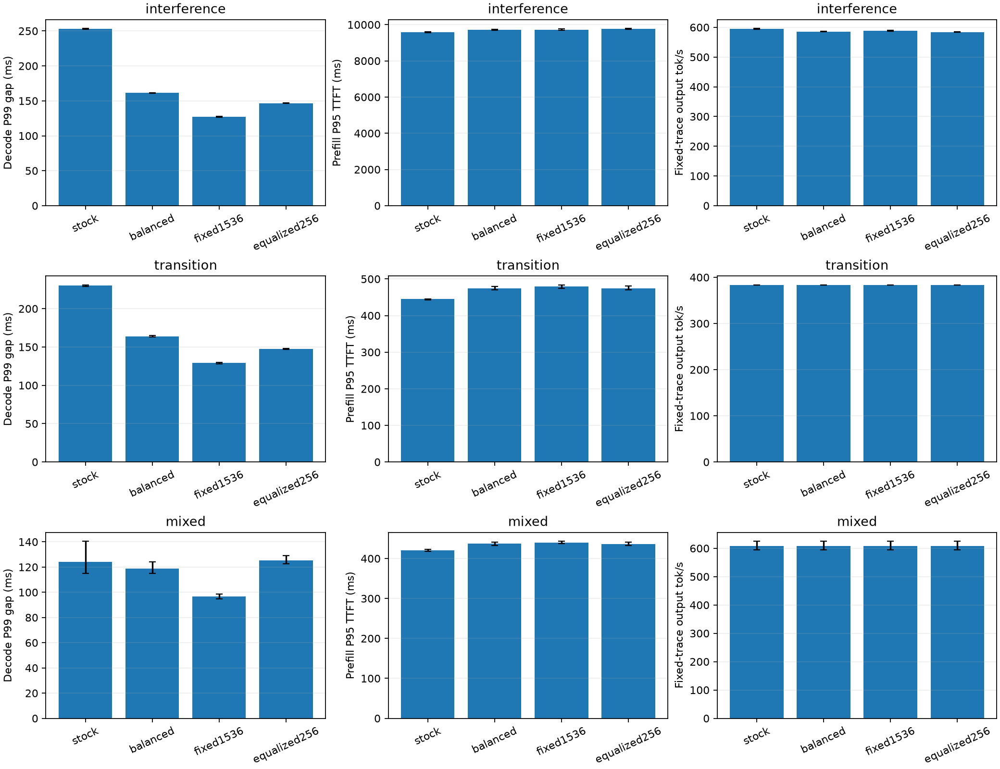
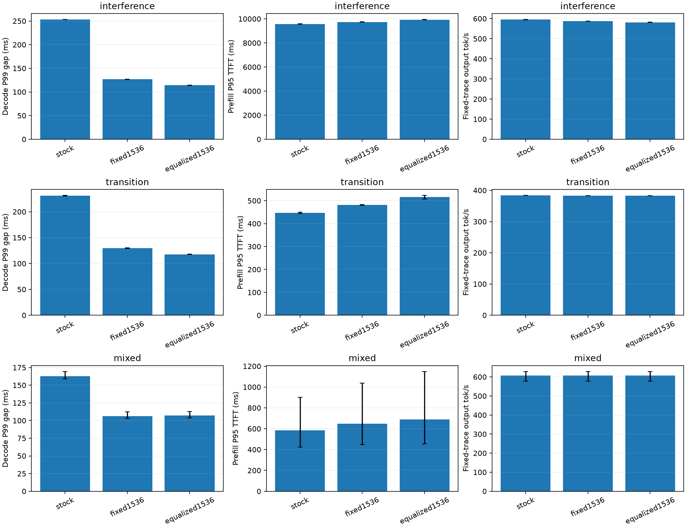

# 动态 Prefill Budget 第二轮优化报告

本轮更好的工程配置是 **1536/4096 两档**：有 Decode 时共享 Prefill 配额为 1536，无 Decode 时放宽到 4096。完整收益和约束区间见独立验证部分。

本轮目标是在上一轮 2048/4096 均衡档基础上继续降低 Decode 尾延迟，并约束相对原生的 Prefill P95 TTFT 增幅不超过 10%、固定 Trace 输出吞吐降幅不超过 5%。本轮已完成独立验证，收益、代价和适用边界见下文。

## 瓶颈与损失来源

### 原反馈目标不可行，控制器长期饱和

上一轮 Joint 使用纯 Decode 标定 P90 的 1.2 倍作为反馈目标。256-token 混合步骤也经常超过这个目标，控制器在 interference 和 transition 的有效 Prefill 步骤中分别有 90.31% 和 97.95% 停在下限。调整 EWMA 或反馈频率不能解决混合计算目标不可行的问题。

负载分档也偏激进：N≥7 时直接将上限压到 512，Joint 再与反馈预算取最小值。上一轮 Load 的干扰场景 Prefill P95 增加 27.02%、吞吐下降 10.32%，已经超出均衡约束。因此损失同时来自负载上限和反馈收缩，不能全部归因于 EWMA 参数。原静态网格包含 1024/2048，未覆盖 1536；本轮补充中间档来检验是否遗漏更好的工作点。

6144-token Prompt 从 2048 切块的 3 次推进增加到 256 切块的 24 次推进，增加前向执行和请求排队成本。上一轮 Joint 的 interference Prefill P95 为 15138.78 ms，原生为 9568.50 ms，输出吞吐从 595.84 降到 489.29 tok/s。小切块缩短单次干扰，但吞吐与 TTFT 代价很大。

### 固定 token 数不能均衡计算时间

同样 2048 token，随着已处理上下文增加，Attention 工作量增加。在历史 seed17 interference 中，2048-token 步骤的 Decode 输出间隔中位数约为：起始位置 0 时 123.0 ms、2048 时 138.1 ms、4096 时 152.2 ms。最后一个长上下文切块构成明显的尾部干扰。

用历史 Fixed-512/1024/2048/4096 的三个种子 17/29/43 拟合非负模型，并用 71/101 留出验证：

\[
\widehat T=6.302+41.679\frac{P}{1024}
+5.026\frac{\sum_i n_i(s_i+(n_i+1)/2)}{10^6}
+0.091N_d+3.320\frac{\sum_j context_j}{10^4}\quad\text{ms}
\]

其中 P 是实际 Prefill token 数，n/s 是各 Prefill 的 token 数与已计算位置，N_d 是实际 Decode token 数。训练 10462 步，稳健重拟合保留 10317 步；留出 7023 步的平均绝对误差为 3.10 ms，绝对误差 P95 为 8.24 ms。完整输入与 Hash 见 [cost_fit.json](optimization_v2/cost_fit.json)。

模型预测的是主机观察到的 Decode 完成间隔，其中包括执行队列与主机处理；它不等于单独 GPU kernel 时间。训练使用的规则切块不能保证模型对任意新批形同样准确，也不能将上述拟合系数解释为严格的算子分解。

### CPU 开销与 GPU 工作划分

上一轮纯决策 P95 约 12 µs、完成反馈约 65 µs，相比混合步数十到数百 ms 的间隔量级较小。Observe 的配对吞吐变化最差区间下界约 -0.425%，因此现有证据更支持 GPU 工作划分、重复前向和排队是主要损失来源。

原 Nsight 采集显示 GEMM 和 Attention 占据主要可见 kernel 活动时长，但不同策略的完成工作量不同，不能直接用累计活动时长之比计算性能收益。当前没有足够数据宣称显存带宽饱和、Tensor Core 利用率提升或精确 Roofline 瓶颈。

## 尝试的优化

### 上下文成本均分

新增 `equalized` 模式，保留每轮共享配额和 Decode 预留，在第一个实际需要 Prefill/Replay 的请求处，按实际计算位置确定共享预算。定义：

\[
W(s,n)=n\left[1+w\left(s+\frac{n+1}{2}\right)\right],\quad w=0.000123475
\]

令剩余量为 R、基础切块为 B、计划剩余步数 k=ceil(R/B)，求解 W(s,n)=W(s,R)/k，然后向上对齐。无 Decode 时仍放宽到 4096；短请求保留基础合计配额以支持批处理；缓存命中的部分从实际计算起点之后才计费。

对于 6144 token、B=2048、16 对齐，切块变为 2464/1984/1696，保持三次推进，降低后段单步负载。计划在每轮根据当前前沿重算，没有额外的每请求历史状态；抢占、取消和缓存命中复用现有记账机制。

该策略是用离线标定系数进行前馈计算。反馈日志继续保留，但 AIMD 不决定该模式的生效预算。

### 固定中间档与规整对齐

新增 Fixed-1536、Fixed-1792 对照，均在无 Decode 时放宽到 4096，以公平比较“有 Decode 时”的配额。另将成本均分的对齐从 16 调整为 256，检查规整批形能否改善执行效率与累计服务时间。

只降低 token 上限也可能取得收益，因此每个候选都需要和固定中间档比较。只有在独立对照中得到证据，才将收益归因于动态算法。

## 初筛与修正记录

第一轮初筛使用新 seed227，三个场景、四个独立服务，共 12 个 Trial，审计错误为 0。interference 的 cohort 指标如下：

| 策略 | Decode P99 ms | Prefill P95 ms | 输出 tok/s |
| --- | ---: | ---: | ---: |
| 原生 | 249.20 | 9459.94 | 599.79 |
| 原均衡档 | 162.25 | 9753.11 | 584.37 |
| Fixed-1536，空闲放宽 | 127.89 | 9797.67 | 585.29 |
| 成本均分 2048，16 对齐 | 144.05 | 9909.41 | 580.50 |

初始成本均分确实降低干扰场景 P99，但弱于 Fixed-1536，且 Mixed 的 P99 从原均衡档 127.86 ms 增到 133.77 ms。transition 的 Prefill P95 从原生 439.74 ms 增到 505.90 ms，超出约束，不选作最终配置。

Fixed-1536 在 transition 的 Prefill P95 为 487.75 ms，增幅约 10.92%，略超约束，也不能仅凭干扰场景的好结果就接受。第二轮继续测试规整对齐与 1792 中间档。

第二轮同 seed227 的修正初筛将成本均分对齐到 256，长 Prompt 的典型三次切块变为 2560/2048/1536。interference 的 P99 为 144.12 ms、Prefill P95 为 9617.34 ms、输出吞吐为 589.60 tok/s；transition 的 P99 为 144.47 ms、Prefill P95 为 466.70 ms。Mixed 的 P99 为 128.86 ms，和原均衡档接近，尚不能证明该场景有增量收益。

Fixed-1792 的 interference Prefill P95 为 10230.16 ms、吞吐为 571.82 tok/s；transition Prefill P95 为 627.27 ms，明显不合格。6144 不能被 1792 整除，后续通过 Ledger 检查跨请求尾块与实际推进次数。固定预算处于两个已有档位之间，并不意味着端到端性能也位于两者之间。

Ledger 复核：interference 中，Fixed-1792 的跨多个 Prefill 请求步骤为 17 个，Fixed-1536 与两种成本均分均为 2 个；长 Prompt 的平均推进次数分别为 4.125、4、3。在 transition 中，Fixed-1792 的典型实际 token 形状为 1792/1792/1792/768，Prefill 服务时间 P95 为 473.22 ms、首次调度前排队 P95 为 78.64 ms；Fixed-1536 分别为 448.74/22.99 ms，256 对齐均分为 430.20/22.27 ms。分位数不相加。这些数据支持尾块形状、跨请求组合与排队节奏共同影响结果；尚不足以把全部损失精确归因到某一个 kernel 或算子。

两次初筛之间存在运行间隔，修正阶段复用了首轮 seed227 的基线用于探索性比较；不能把这种比较当成控制了时间漂移的最终配对结论。独立验证重新启动全部基线服务。

成本均分保持三次推进，仍未确保累计服务时间更低：transition 的 Prefill 服务时间中位数，原均衡档约 417.0 ms，初始成本均分约 431.7 ms。服务时间、调度前排队和端到端 TTFT 的分位数不能直接相加。此结果说明“拟合成本相等”并不足以保证最优端到端表现。

## 独立验证与最终选择

独立验证使用预先登记的新种子 **307/311/313/317/331**。四组各五个独立服务，轮内随机化顺序。下表是五次均值，变化与区间采用逐种子配对计算。

| 场景 | 策略 | Decode P99 ms | Prefill P95 ms | 固定 Trace 输出 tok/s |
| --- | --- | ---: | ---: | ---: |
| interference | stock | 252.88 | 9586.21 | 594.89 |
| interference | balanced | 161.52 | 9720.40 | 585.92 |
| interference | fixed1536 | 126.95 | 9727.70 | 588.16 |
| interference | equalized256 | 146.69 | 9760.90 | 584.48 |
| transition | stock | 230.00 | 444.83 | 383.58 |
| transition | balanced | 164.06 | 474.72 | 383.36 |
| transition | fixed1536 | 129.01 | 479.54 | 383.41 |
| transition | equalized256 | 147.30 | 474.46 | 383.32 |
| mixed | stock | 124.06 | 420.44 | 608.83 |
| mixed | balanced | 118.80 | 436.81 | 608.50 |
| mixed | fixed1536 | 96.53 | 440.08 | 608.63 |
| mixed | equalized256 | 125.38 | 436.46 | 608.51 |

五种子阶段的工程选择为 **fixed1536**，单独配置保存为 `configs/presets/fixed1536.json`。选择规则：先要求三个场景的 TTFT/吞吐点估计全部满足约束，再比较两个预定主场景的配对 P99 变化均值。区间约束是否通过，仍须看下方验收表；不将点估计通过写成区间保证。最终别名 `balanced_v2.json` 的选择还包括后文额外验证。

阶段选择相对原均衡档：

| 场景 | Decode P99 | Prefill P95 | 输出 tok/s |
| --- | --- | --- | --- |
| interference | -21.40% [-21.98, -20.88] | +0.08% [-0.55, +0.54] | +0.38% [+0.06, +0.77] |
| transition | -21.36% [-22.18, -20.66] | +1.03% [-0.46, +2.47] | +0.01% [-0.00, +0.03] |
| mixed | -18.66% [-20.55, -17.40] | +0.75% [+0.17, +1.24] | +0.02% [+0.01, +0.03] |

阶段选择相对新鲜原生：

| 场景 | Decode P99 | Prefill P95 | 输出 tok/s |
| --- | --- | --- | --- |
| interference | -49.80% [-50.12, -49.49] | +1.48% [+0.88, +1.89] | -1.13% [-1.41, -0.75] |
| transition | -43.91% [-44.33, -43.51] | +7.81% [+6.58, +8.91] | -0.04% [-0.05, -0.03] |
| mixed | -21.20% [-28.80, -16.92] | +4.67% [+4.33, +5.04] | -0.03% [-0.07, -0.01] |

相对原均衡档，成本均分的配对变化及 95% 区间：

| 场景 | Decode P99 | Prefill P95 | 输出 tok/s |
| --- | --- | --- | --- |
| interference | -9.18% [-9.55, -8.91] | +0.42% [+0.01, +0.82] | -0.25% [-0.53, +0.04] |
| transition | -10.21% [-10.92, -9.38] | -0.04% [-1.82, +1.75] | -0.01% [-0.03, +0.01] |
| mixed | +5.61% [+4.23, +6.76] | -0.08% [-0.61, +0.46] | +0.00% [-0.01, +0.01] |

相对新鲜原生基线：

| 场景 | Decode P99 | Prefill P95 | 输出 tok/s |
| --- | --- | --- | --- |
| interference | -41.99% [-42.20, -41.80] | +1.82% [+1.56, +2.06] | -1.75% [-1.94, -1.54] |
| transition | -35.96% [-36.27, -35.51] | +6.66% [+5.36, +8.25] | -0.07% [-0.09, -0.05] |
| mixed | +2.25% [-6.91, +7.38] | +3.81% [+3.18, +4.46] | -0.05% [-0.08, -0.04] |

相对更强的 Fixed-1536 静态对照：

| 场景 | Decode P99 | Prefill P95 | 输出 tok/s |
| --- | --- | --- | --- |
| interference | +15.55% [+15.13, +15.97] | +0.34% [-0.03, +0.72] | -0.63% [-0.88, -0.38] |
| transition | +14.19% [+13.23, +15.14] | -1.04% [-2.62, +0.77] | -0.02% [-0.04, -0.00] |
| mixed | +29.87% [+28.80, +31.25] | -0.82% [-1.45, -0.25] | -0.02% [-0.03, -0.01] |

约束验收（相对原生：Prefill P95≤+10%，吞吐≥−5%；区间验收要求对应区间全部位于边界内）：

| 策略 | 场景 | 点估计满足约束 | 95% 区间满足约束 | P99 改善区间不跨零 |
| --- | --- | --- | --- | --- |
| balanced | interference | 是 | 是 | 是 |
| balanced | transition | 是 | 是 | 是 |
| balanced | mixed | 是 | 是 | 否 |
| fixed1536 | interference | 是 | 是 | 是 |
| fixed1536 | transition | 是 | 是 | 是 |
| fixed1536 | mixed | 是 | 是 | 是 |
| equalized256 | interference | 是 | 是 | 是 |
| equalized256 | transition | 是 | 是 | 是 |
| equalized256 | mixed | 是 | 是 | 否 |

2048 基础预算候选的判断：成本均分在两个预定主场景同时通过区间约束，并有明确的 P99 改善。
相对原均衡档的两个主场景 P99 改善均获得本批配对区间支持。
Fixed-1536 提供了另一组时延/TTFT 取舍；成本均分的价值须结合 TTFT 和吞吐评价，不能仅凭策略复杂度宣称优于最佳静态。

五次重复仅描述本机本批实验变异。Mixed 的 P99 包括全部请求，不等同于固定 Decode cohort；吞吐包含固定到达时序和排空时间，不是最大稳定容量。区间采用 5000 次按种子 bootstrap，未作多重比较校正。

## 同基础预算的额外验证

第一组新种子显示 Fixed-1536 比 2048 基础预算候选更强，随后登记三个未使用的新种子 **401/409/419**，比较原生、Fixed-1536 与基础预算同为 1536 的成本均分。此阶段在前一阶段结果之后提出，单独保留协议和结论，不合并成原先的五次重复。

新候选仍使用同一求解器与标定系数，改为 512 对齐。6144-token Prompt 的典型切块为 2048/1536/1536/1024，与静态 1536 的四次推进对齐；由此检验同基础预算下的成本均分收益。

| 场景 | 策略 | Decode P99 ms | Prefill P95 ms | 输出 tok/s |
| --- | --- | ---: | ---: | ---: |
| interference | stock | 253.07 | 9574.37 | 595.22 |
| interference | fixed1536 | 126.79 | 9736.61 | 587.77 |
| interference | equalized1536 | 114.36 | 9934.23 | 581.55 |
| transition | stock | 230.80 | 446.77 | 383.57 |
| transition | fixed1536 | 129.56 | 481.75 | 383.36 |
| transition | equalized1536 | 117.63 | 515.89 | 383.25 |
| mixed | stock | 162.71 | 585.25 | 607.07 |
| mixed | fixed1536 | 106.30 | 647.09 | 606.80 |
| mixed | equalized1536 | 107.10 | 690.33 | 606.72 |

额外候选相对 stock 的三种子配对变化：

| 场景 | Decode P99 | Prefill P95 | 输出 tok/s |
| --- | --- | --- | --- |
| interference | -54.81% [-55.00, -54.66] | +3.76% [+3.59, +3.93] | -2.30% [-2.41, -2.18] |
| transition | -49.03% [-49.17, -48.93] | +15.48% [+12.98, +16.98] | -0.08% [-0.09, -0.08] |
| mixed | -34.20% [-34.64, -33.37] | +14.45% [+7.27, +27.40] | -0.06% [-0.06, -0.05] |

额外候选相对 fixed1536 的三种子配对变化：

| 场景 | Decode P99 | Prefill P95 | 输出 tok/s |
| --- | --- | --- | --- |
| interference | -9.80% [-9.89, -9.73] | +2.03% [+2.02, +2.04] | -1.06% [-1.09, -1.04] |
| transition | -9.20% [-9.67, -8.50] | +7.09% [+5.14, +8.45] | -0.03% [-0.04, -0.02] |
| mixed | +0.76% [+0.26, +1.23] | +4.95% [+1.44, +10.69] | -0.01% [-0.02, -0.01] |

额外候选未同时满足全部晋级条件，最终保留前阶段选择。成本均分可能降低峰值，却增加短 Prompt 批处理、尾块或排队代价；具体负结果保留在表中，不把该候选宣称为全面优于静态。

为核查批处理机制，使用真实 V1 Scheduler/KV Manager 做独立 CPU 状态实验：一个存量 Decode 请求，加八个 2048-token Prompt，基础预算均为 1536。模型输出由确定性模拟器提供，以下只比较调度次数，不测 GPU 时间。

| 模式 | Async | 含 Prefill 步骤 | 含多个 Prefill 请求的步骤 | 总 Prompt token |
| --- | --- | ---: | ---: | ---: |
| fixed | False | 11 | 5 | 16384 |
| equalized | False | 16 | 0 | 16384 |
| fixed | True | 11 | 5 | 16384 |
| equalized | True | 16 | 0 | 16384 |

成本均分模式在长于基础预算的请求尾部，按剩余量收紧全局共享配额；固定模式可以把剩余配额交给后续请求。相同 token 总量可能因此需要不同数量的全局步骤。完整 GPU Trace 的尾块、批处理和队列数据保存在 diagnostics.json，可与上述受控状态实验交叉核对。

## 输出、记账与来源检查

本轮主矩阵纳入 **134 个 Trial / 35 个服务**：105 个性能 Trial、29 个质量 Trial；另有五个有效节点 Profile 服务，独立保存。中断轮次的8个已完成Trial归档后整轮重跑，不计入主矩阵。全部主矩阵原始数据审计错误为 0。30 项回归通过，包含 256/512 对齐的同步/异步共享配额、部分缓存前沿、抢占 Replay 和状态清理。

| 策略 | 自然问答逐 token 一致 | 合成尾块逐 token 一致 |
| --- | ---: | ---: |
| balanced (opt_validation) | 30/30 | 25/25 |
| fixed1536 (opt_validation) | 30/30 | 25/25 |
| equalized256 (opt_validation) | 30/30 | 25/25 |
| fixed1536 (opt_match1536) | 18/18 | 14/15 |
| equalized1536 (opt_match1536) | 18/18 | 15/15 |

检测到输出差异，原始 ID、首个差异位置和文本保存在 diagnostics.json。独立重复与公共前缀 logprob 诊断如下；原始差异保留，不改写为全部一致。

补充阶段 Fixed-1536 的 seed419 / tail1 在第 11 个输出产生差异：原生 token=429，固定档 token=323，此前 10 个输出一致。

随后使用相同 Trace 和关闭 Prefix Cache 的新鲜 stock/off/Fixed-1536 各两次，共六个诊断服务，独立于性能矩阵。

| 新鲜重复 | stock/off 逐 token 一致 | stock/Fixed-1536 逐 token 一致 |
| --- | ---: | ---: |
| 1 | 11/11 | 11/11 |
| 2 | 11/11 | 11/11 |

其中 6 个诊断服务记录了 logprob Top-K 内核首次编译警告。原始性能审计中的 JIT 拒绝项与日志保留；诊断仅要求请求、长度、Trace 和响应完整，不使用这些服务的时延或吞吐作性能证据。主性能矩阵的 JIT 审计未放宽。

Teacher-forced 将共同前缀强制追加到输入，自回归检查原始输入的对应位置；offered batch 为1/2/8。自回归公共前缀不一致的样本不用于同上下文比较。

| 策略 | 检查 | 同前缀样本/总样本 | Top1−Top2 logprob差最小/最大 |
| --- | --- | ---: | ---: |
| stock | teacher_forced | 6/6 | 0.015625/0.015625 |
| stock | autoregressive | 6/6 | 0.000000/0.031250 |
| off | teacher_forced | 6/6 | 0.015625/0.015625 |
| off | autoregressive | 6/6 | 0.000000/0.015625 |
| fixed1536 | teacher_forced | 6/6 | 0.015625/0.015625 |
| fixed1536 | autoregressive | 6/6 | 0.000000/0.031250 |

六个新鲜服务的原始 correctness 重复均回到原 stock 分支；另外的自回归批次探测中，未修改 stock 完整复现了原 Fixed-1536 的全部 32 个输出 token：

| stock 重复 | offered batch | 原 Fixed 全部32 token一致 | 第11位 Top1−Top2差 |
| --- | ---: | --- | ---: |
| 1 | 2 | 是 | 0.000000 |
| 2 | 2 | 是 | 0.000000 |

这些样本的前10个输出与原始共同前缀一致，第11位候选“ that”和“ and”的返回 logprob 并列。直接证据说明未修改 stock 在改变提供的并发批次后也会产生同一续写分支，支持原生批次/数值敏感性的解释。offered batch 表示同时提交的请求数，不等同于每步实际 GPU 批大小；诊断还启用了 logprobs，不能据此断言已还原原始运行的精确数值路径。未发现新增调度记账错误，原始差异仍计为不一致。完整 token 比较见 numerical_batch_reproduction.json。

自然问答与合成尾块的结果分别列出。有限一致性检查和候选 logprob 诊断不替代完整任务质量评估，也不保证任意 FP16 异步批形逐 token 一致。完整响应与原始 logprobs 见 numerical_probe.json 和运行目录 quality_drift_opt/。

来源检查共 273 项通过，包括原安装的固定源码、源码覆盖层、旧轮归档、每个服务的冻结来源及模型文件 SHA256。全局 token 上限始终为 4096，实际 Prompt+Replay 不超过当轮配额；非空提交与完成一一对应，无在途残留或遥测丢失。

新组 CPU 计时先对每个服务取 P95，再按阶段取服务均值：

| 策略 | decide 阶段 P95 µs | 完整调度 P95 µs | 完成反馈 P95 µs |
| --- | ---: | ---: | ---: |
| balanced (opt_validation) | 12.08 | 795.76 | 64.47 |
| fixed1536 (opt_validation) | 6.48 | 817.84 | 64.30 |
| equalized256 (opt_validation) | 5.62 | 783.34 | 64.05 |
| fixed1536 (opt_match1536) | 6.49 | 884.44 | 65.57 |
| equalized1536 (opt_match1536) | 5.64 | 942.94 | 66.38 |

decide 计时不含 clip 中的成本求解，完整调度计时包含求解与原生调度。策略改变请求状态和推进次数，完整调度差值不能直接解释为纯算法开销；也没有同构的 stock 内部计时作为相对开销分母。

## GPU 节点诊断

五个独立 Nsight 节点采集使用 seed919、预热后 128 个完成回调。所有采集均通过记账审计，未加入性能表。

| 策略 | 逻辑完成 Prompt token | Decode token | 可见 kernel 数 | 图内 kernel 数 | GEMM 活动合计 ms | Attention 活动合计 ms |
| --- | ---: | ---: | ---: | ---: | ---: | ---: |
| balanced | 53248 | 1898 | 47157 | 37230 | 2816.00 | 1698.79 |
| fixed1536 | 53248 | 1852 | 46398 | 33945 | 2746.53 | 1721.76 |
| equalized | 53248 | 1898 | 47157 | 37230 | 2905.19 | 1722.72 |
| equalized256 | 53248 | 1898 | 47157 | 37230 | 2847.69 | 1714.72 |
| equalized1536 | 53248 | 1852 | 46398 | 33945 | 2822.62 | 1735.60 |

另保留一次采集完成后审计失败的诊断：最初目录名 balanced 被旧审计逻辑当成原有冻结阶段，查找不存在的 formal-source.json。统一改为 node- 前缀目录后重采并通过，原始失败产物保存在 diagnostic_profiles/balanced/；该失败不影响性能矩阵，也未加入上述五组有效采集。

函数名分类仅为启发式归类。不同窗口的 Decode 工作量、请求状态和边缘在途工作可能不同，且 Profiler 会扰动执行；活动时长之和不等于墙钟时间、利用率或可加的阶段成本。这些数据用于核查主要 GPU 活动与图内覆盖，不按合计时间比值宣称优化收益。

新策略未改变模型 kernel、KV 分配或全局编译缓冲区。本轮主要机制证据为实际切块、完成间隔与请求排队的受控对照。时钟未锁定，随机化轮内顺序和新鲜基线降低漂移影响，但不能消除全部系统偏差。

## 交互中断与恢复

2026-10-20 18:30 检查发现，外层运行器和客户端进程已退出，13:08 启动的一个原生 API 服务成为空闲孤立进程，GPU 无计算负载。没有证据表明模型计算挂死。已清理本项目的孤立服务，原始日志完整归档至 `interruptions/20261020-1830/`。

前三个完整种子继续保留。第四个种子 317 已完成两个服务、共 8 个 Trial，但下一服务与它们存在约五小时间隔；为避免同轮基线漂移，这两个服务全部移出主矩阵归档，按原登记顺序重跑该种子的四组。排除依据为执行中断与时间断层，不根据性能好坏筛选数据。归档完成数据不计入主表的有效 Trial 数。

恢复采用独立 Session 的后台主运行器，串行执行剩余验证、同基础预算验证、节点诊断、分析、权重校验和报告生成，并保存阶段状态与 PID。交互终端退出不再依赖其父进程维持流水线。恢复前后没有改变冻结的在线代码或模型。时钟仍未锁定，跨时段系统漂移是实验限制；每个种子整轮使用新鲜基线并保留硬件采样。

## 复现与证据

新实验根目录：`/mnt/ondeviceinfer/experiments/adaptive_prefill_budget_v0320_opt2`。原 421 个 Trial 仍位于原目录，新轮次不写入上一轮汇总。

- [逐阶段实验表](optimization_v2/实验数据表.md)
- [原始数据审计汇总](optimization_v2/audits.json)
- [配对比较](optimization_v2/comparisons.json)
- [成本拟合及输入 Hash](optimization_v2/cost_fit.json)
- [后台运行与中断恢复](../docs/优化实验运行与恢复.md)
- 旧版代码保存在新实验根目录的 `baseline_source/`，各新阶段的冻结在线代码保存在 `snapshots/`。

实验仍使用 Qwen3-1.7B FP16、单 RTX 3090、vLLM 0.32.0+cu129、默认 Async/CUDA Graph 路径、全局 4096 token、16 序列、关闭 Prefix Cache。Mixed 为 200 请求、2.422 RPS 的有限开放注入 Trace；输出 tok/s 含注入和排空时长，不能据此宣称最大稳定容量提升。初筛单种子仅用于选择候选；最终区间描述本机有限重复，不外推到其他模型或 GPU。
